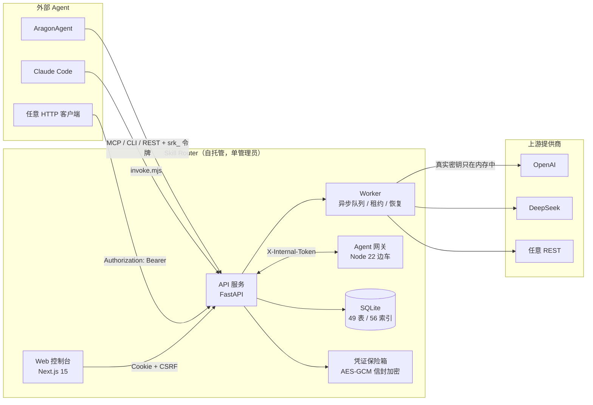

<div align="center">

# Skill Router

**单管理员的 AI 能力中枢** —— 把上游 API 凭证锁进信封加密的保险箱，把每个接口描述成带
输入/输出 Schema 的能力，用内置 Agent 完成「读懂 → 联调 → 发布」，
再以 SKILL 的形式版本化分发给你所有的外部 Agent。

外部 Agent 只拿一个平台令牌，就能**动态发现并调用**能力，却永远接触不到上游真实密钥。

[](apps/api/requirements.txt)
[](apps/web/package.json)
[](apps/web/package.json)
[](apps/api/requirements.txt)
[](db/)
[](#质量与证据)
[](docs/api/openapi.json)
[](packages/skillrouter-cli/package.json)

[快速开始](#3-分钟跑起来) · [架构](#架构) · [端到端示例](#端到端一个能力从零到被-agent-调用) ·
[安全模型](#安全模型) · [质量与证据](#质量与证据) · [文档地图](#文档地图)

</div>

---

## 这个项目与众不同的一点

绝大多数项目在 README 里写「已实现 / 已完成」。本项目**禁止**这样做：

> **没有证据就不许写「已验证」。**
> 每个能力只有四种状态 —— **已实现**（有代码）/ **部分实现**（点名缺什么）/
> **未实现**（本轮不做）/ **待验证**（代码在，但缺真实环境证据）。
> 标了「待验证」的条目，**不允许**因为「看起来能跑」而改成已验证；只有
> [`verification-checklist.md`](docs/runbook/verification-checklist.md) 里登记了
> 命令、输出、`request_id`、时间、环境，才能改状态。

因此本 README 里每个数字都能追到一条可复现的命令（见 [质量与证据](#质量与证据)），
每个「还没做」都写在 [仍未验证](#仍未验证的部分按规矩保持待验证) 里而不是悄悄删掉。

---

## 目录

- [它解决什么问题](#它解决什么问题)
- [它是什么 / 它不是什么](#它是什么--它不是什么)
- [架构](#架构)
- [核心概念](#核心概念)
- [3 分钟跑起来](#3-分钟跑起来)
- [端到端：一个能力从零到被 Agent 调用](#端到端一个能力从零到被-agent-调用)
- [安全模型](#安全模型)
- [质量与证据](#质量与证据)
- [技术栈](#技术栈)
- [代码结构](#代码结构)
- [文档地图](#文档地图)
- [运维速查](#运维速查)
- [上游与许可](#上游与许可)

---

## 它解决什么问题

| 现状痛点 | Skill Router 的做法 |
|---|---|
| 密钥散落在 `.env`、CI 变量、每个人的笔记本里 | **凭证信封加密**（AES-GCM，主密钥留在数据库之外，0600）；前端只见掩码与指纹，日志 / 导出包 / 连接包**零明文** |
| 「这个 SDK 能不能用这个模型」「这张图该走哪家」没有统一答案 | **标准能力**（对外契约）+ 多条 **route**（各自绑定提供商凭证、参数映射、限额）；按优先级 / 健康 / 配额路由，并做**受限**故障切换 |
| 接入一个 API 全靠手工，过程不可复现、无法审计 | 内置 Agent 的**七步接入流程**（解析 → 草案 → 校验 → 测试 → 样例 → 检查 → 发布），每步落库、可续跑；**没有真实测试证据就不许发布** |
| 每个 Agent 各自手写 HTTP、各自存密钥 | **连接包 + `invoke.mjs`**：Agent 只需一条稳定命令；令牌走 stdin，不进 argv、不进 shell 历史 |
| 出问题查不到原因 | **调用记录**（路由决策 / 重试链 / 耗时分解 / 脱敏预览）+ **审计**（凭证、发布、撤销、升级）+ `X-Request-Id` 贯穿全链路 |

## 它是什么 / 它不是什么

**是**：一个**单管理员**、可自托管的控制面。它管理凭证、能力契约、路由策略、SKILL 版本，
以及外部 Agent 的令牌作用域与预算。它自己**不是**推理引擎，**不**训练、**不**缓存模型权重。

**不是**：

- **不是多租户 SaaS。** 只有一个管理员账号，没有组织 / 团队 / RBAC 层级。要多人协作请在前面加一层你自己的认证代理。
- **不是计费系统。** 有预算阈值与用量记录（`usage_records`），但不产生账单、不对账第三方发票。
- **不是 LLM 专用的代理。** 能力是通用的 HTTP 契约（文本 / 图像 / 视频 / 语音 / 通用 HTTP）；LLM 只是其中一类。
- **不是密钥分发器。** 外部调用方**永远**拿不到上游密钥——它在服务端解密、只用于出站请求，不落日志、不回前端。
- **不是「装完就能用」的成品。** 它需要真实的第三方凭证才能算「已验证」；缺凭证的部分会诚实地标成待验证。

## 架构



四条边界：

1. **保存密钥的**只有保险箱；出站请求时在服务端解密，用完即弃。
2. **写权限**只在 API（Worker 与网关各自走受控路径，共用一个 SQLite 库）。
3. **Agent 网关**是 Node 边车，只暴露 12 个 `sr_*` 平台工具，**不注册**任何上游内置工具（`bash` / `read_file` / `web` 等一律不可用）。
4. **外部调用**只走 `/api/v1` + 平台令牌，作用域 / 配额 / 预算三重限制。

## 核心概念

| 概念 | 是什么 | 一句话说明 |
|---|---|---|
| **Provider** | 提供商 | 上游服务的归属单位（`base_url`、分类、环境）。删除前必须先解除凭证与能力引用。 |
| **Credential** | 凭证 | 加密存储的密钥 + 掩码 + 指纹。支持**检测有效性**（真实打上游探测）、**替换密文**、**轮换**（新建一行并原子切换引用）。 |
| **Capability** | 能力 | 对外契约：`key` + 输入/输出 JSON Schema + 调用模式 + 示例 + `routes[]`。**四个状态彼此独立**：已保存 / 测试通过 / 已发布 / 可调用。 |
| **Route** | 通道 | 能力在某个提供商上的实现：`url_template`、参数映射、响应映射、错误映射、限额、超时重试、优先级。 |
| **SKILL** | 分发单元 | 能力组合 + 执行计划 + 权限声明，版本化发布；**已发布**决定版本，**已启用**决定当前是否对外可见 —— 两者独立。 |
| **Token** | 平台令牌 | `srk_<keyid>_<secret>`，只在创建时完整显示一次；平台只存 `sha256`。作用域 + RPM/并发/日上限/预算。 |

> 为什么「发布」这么啰嗦？因为**没有证据的发布等于把线上事故写进版本号**。
> 发布闸门只认**24 小时内落库的一次成功测试**（读 `test_runs`，与页面上的「测试通过」徽标同源），
> 且要求配置已保存、版本号语义化、变更说明填写。

## 3 分钟跑起来

前置：**Python 3.11**、**Node ≥ 22**（CLI 助手 `invoke.mjs` 只要 Node ≥ 18）。

```bash
# 0) 依赖
cd apps/api                 && pip install -r requirements-dev.txt   && cd ../..
cd agents/aragon-gateway    && npm install --include=dev             && cd ../..
cd apps/web                 && npm install --include=dev             && cd ../..
cd packages/skillrouter-cli && npm install --include=dev             && cd ../..
```

```bash
# 1) 配置：从模板生成（模板里没有任何真实密钥）
cp deploy/.env.example .env
python -c "import secrets;print(secrets.token_urlsafe(32))"   # 填进 SKILLROUTER_AGENT_GATEWAY_SECRET
# 本地开发把 SKILLROUTER_ENV 改成 development

# 2) 初始化：建库 + 管理员 + 目录 + 迁移
python scripts/bootstrap.py
```

<details open>
<summary><b>Windows 一条命令（推荐）</b></summary>

```bat
powershell -NoProfile -ExecutionPolicy Bypass -File .\start.ps1
```

它会：检查/安装依赖 → 首次生成 `.env`（随机网关密钥）→ 用**绝对路径**固定
`SKILLROUTER_DATA_DIR` / `SKILLROUTER_DB_PATH` → 跑 `bootstrap.py` → 后台起
gateway / api / worker / web 并逐个探测就绪 → 打开 `/login`。

Ctrl+C 停全部；`-Action status | stop | restart | logs | check` 管生命周期，
`-Components api,web` 只起前后端，`-NoFollow` 不滚日志。
日志落在 `var/logs/dev/<组件>.out.log`。

</details>

<details>
<summary><b>四个终端手动起（跨平台）</b></summary>

```bash
cd apps/api && python -m uvicorn skillrouter_api.main:app --reload --port 8000   # API
cd apps/api && python -m skillrouter_api.worker                                   # Worker
cd agents/aragon-gateway && npm run dev                                           # 网关（8500）
cd apps/web && npm run dev                                                        # 控制台（3000）
```

POSIX 等价命令见 [spec §14.1](docs/plans/skill-router/spec.md)；
或 `make help` / `.\make.ps1 help`（`install / dev / test / lint / typecheck / e2e / up / down / backup / restore / seed / perf`）。

</details>

首次登录：**`admin` / `adminjr`** → 立即被强制改密（≥12 字符、含字母+数字、不等于默认值）。
默认密码只在 `admin_initialized != '1'` 时创建**一次**，重启或升级**不会**复活它。

<details>
<summary><b>容器部署</b></summary>

```bash
cp deploy/.env.example deploy/.env    # 填主密钥、网关密钥、对外域名
docker compose -f deploy/docker-compose.yml up -d
```

五个服务：`api` / `worker` / `gateway` / `web` / `proxy`（nginx），带健康检查与
`depends_on: service_healthy`；网关只在内部网络可达、**不发布端口**；nginx 负责
TLS 1.2+ / HSTS / SSE 不缓冲。

> 上生产前请把 compose 与三个 Dockerfile 里的基础镜像**固定到 digest**（模板中标 `<fill-me>` 的位置）。
> 本机无 Docker，这部分仍是**待验证**（见 [质量与证据](#质量与证据)）。

</details>

## 端到端：一个能力从零到被 Agent 调用

下面全部是真实命令；上游用本机 echo 服务，因此不需要任何第三方密钥就能复现整条链路。

**① 管起来**（控制台或 API）：建提供商 → 加凭证（掩码 `echo-***9999`）→
点「检测有效性」→ 平台真的去请求上游 `/models`，返回 `200`、最近验证变成「刚刚」。

**② 配能力**：向导填 key（如 `text.generate.echo`）→ 选提供商与凭证 →
`url_template` 写 `{base_url}/v1/generate` → 创建草稿。

**③ 联调**：点「发送测试」→ 真实打到上游：

```text
状态 succeeded · HTTP 200 · 耗时 198ms · 实际 route rt_primary · 未选中 route 0
响应预览（脱敏）{"result": {"text": "echo:你好"}, "usage": {"input_tokens": 11, "output_tokens": 3}}
```

**④ 发布**：填 `1.0.0` + 变更说明 → 四个徽标变成
`已保存 / 测试通过 / 已发布 / 可调用`。

**⑤ 分发**：新建外部 Agent → 签发令牌（**只显示一次**）→ 复制安装命令：

```bash
# 令牌走 stdin：不进 argv、不进 shell 历史、不进 ps
npx ./skillrouter-cli-0.1.0.tgz install --base-url https://router.example.com --token-stdin < token.txt
```

**⑥ 外部 Agent 调用**（零依赖，Node ≥ 18）：

```bash
node ./invoke.mjs capabilities.list                     # 动态发现（平台新增能力即时出现）
node ./invoke.mjs capabilities.get text.generate.echo   # 看输入 Schema 与示例
node ./invoke.mjs invoke --capability text.generate.echo --input '{"prompt":"你好"}'
node ./invoke.mjs invoke --capability image.generate.kling --mode async \
  --input '{"prompt":"雨中的柴犬"}'                        # 异步：立刻拿 task_id
node ./invoke.mjs task.status tsk_01J9Z9AB
```

或者直接打 HTTP：

```bash
curl -sS -X POST "$SR_BASE/api/v1/capabilities/text.generate.echo/invoke" \
  -H "Authorization: Bearer $SR_TOKEN" -H "Content-Type: application/json" \
  -H "Idempotency-Key: agent-a-94f2" \
  -d '{"input":{"prompt":"用一句话解释信封加密"},"options":{"mode":"sync"}}'
```

```json
{
  "request_id": "req_33daf7a7f0f14a9fa32d0c3c",
  "status": "succeeded",
  "capability": { "key": "text.generate.echo", "version": "1.0.0" },
  "provider": { "id": "prv_...", "name": "Echo Upstream" },
  "output": { "result": { "text": "echo:你好" } },
  "usage": { "unit": "tokens", "source": "estimated", "cost_usd": 0.0 },
  "timings": { "queue_ms": 0, "upstream_ms": 180, "total_ms": 210 }
}
```

**⑦ 查账**：`/calls` 出现这条记录 → 点开看到**路由决策**（选中/丢弃原因）、
**耗时分解**、**重试链**、**脱敏后的请求与响应**。`X-Request-Id` 一路贯穿到审计日志。

> 上面每一步都在有头 Chrome 里跑过，证据见
> [verification-report.md §10](docs/runbook/verification-report.md)。

## 安全模型

| 威胁 | 机制 | 边界说明 |
|---|---|---|
| 上游密钥泄漏 | AES-GCM 信封加密；主密钥在库外（env 或 `var/credentials-master.key` 0600）；前端只出掩码 + 指纹 | **主密钥丢失 = 凭证全部报废**；备份只导指纹 `sha256(key)[:16]`，从不导密钥 |
| 日志 / 导出包泄漏明文 | 载荷策略 `none` / `redacted_preview` / `full`（仅建议测试环境）；连接包与 SKILL 包零密钥 | 平台只保证**自己**不泄漏；`full` 模式下数据库里就是明文 |
| 令牌泄漏 | 只在创建时返回一次，库里只有 `sha256`；走 `Authorization` 头，查询串通道**默认关闭** | 令牌进 argv 仍是风险 → 所有命令默认 `--token-stdin` |
| 越权调用 | 令牌**作用域** + RPM / 并发 / 日上限 / 预算四层限额 | 真正的边界是这四层，**不是** SKILL.md 里的声明文案 |
| SSRF（Agent 抓外网） | 出站白名单 + 默认拒绝内网段与云元数据地址 | 管理员显式配的 `base_url` 只禁非 http(s) 与元数据地址（否则本机 Ollama 之类的自托管上游永远连不上） |
| Agent 拿到 shell | 网关只注册 12 个 `sr_*` 工具，**未注册** `bash` / `write_file` / `read_file` / `web` | 这是刻意的一刀切：Agent 能做的事 = 这 12 个工具能做的事 |
| 默认密码被复活 | `admin_initialized` 标记；重启 / 升级不会重建默认账号 | 忘记密码用 `python scripts\bootstrap.py reset-admin-password --user admin` |
| 会话与 CSRF | Cookie 会话 + `sr_csrf` 双提交；写请求必须带 `X-CSRF-Token` | 生产强制 HTTPS Cookie |

**别把这些提交进仓库**：`.env`、`credentials-master.key`、`var/`（`.gitignore` 已覆盖）。

## 质量与证据

### 状态口径

| 状态 | 含义 |
|---|---|
| 已实现 | 有代码，且有单元 / 契约测试 |
| 部分实现 | 有代码，但点名缺哪一块 |
| 未实现 | 本轮明确不做 |
| **待验证** | 代码在，缺**真实环境**证据（真实凭证 / 真实 Agent / 真机 / 真 Docker） |

### 本轮实测（可复现，命令即证据）

| 套件 | 命令 | 结果 |
|---|---|---|
| 后端全量 | `cd apps/api && python -m pytest tests -q` | **247 passed**（27 个文件） |
| Agent 网关 | `cd agents/aragon-gateway && npx vitest run` | **48 passed**（4 个文件） |
| npm CLI | `cd packages/skillrouter-cli && npx vitest run` | **37 passed**（3 个文件） |
| 浏览器 e2e（有头 Chrome） | `cd apps/web && npx playwright test --headed` | **9 passed / 2 skipped**（2 条需真实模型引擎） |
| 前端类型 / lint / 构建 | `npx tsc --noEmit` / `npx next lint` / `npm run build` | 0 错误 / 0 warning / 构建成功 |
| 端到端真联调 | `python scripts/e2e_live.py` | **70/70**（真实 uvicorn + 真实 HTTP 上游 + 真实 CLI 安装与调用） |
| 网关联通 | `python scripts/check_gateway.py` | **12/12**（真实网关进程 + 引擎 0.2.34 + 热切换） |
| 前端联通 | `python scripts/check_web.py` | **9/9**（Next 反代、X-Request-Id、未登录 401） |
| 迁移 | `python -m alembic -c migrations/alembic.ini upgrade head` | 49 表 / 56 索引 / 2 触发器，`user_version=2` |

合计 **341 项测试通过**（247 + 48 + 37 + 9），2 项按设计跳过。
完整命令与输出归档在 [`docs/runbook/verification-report.md`](docs/runbook/verification-report.md)，
逐项验收状态以 [`verification-checklist.md`](docs/runbook/verification-checklist.md) 为**唯一权威**。

### 仍未验证的部分（按规矩保持待验证）

| 项 | 为什么 |
|---|---|
| 真实第三方凭证联调（文本 / 语音 / 异步 / 跨提供商故障切换） | 本机无真实第三方 Key |
| 内置 Agent **真实模型推理**（对话 / 工具流 / 停止报告） | 无可用模型凭证；网关未接真实 provider |
| 真实外部 Agent 安装 → 发现 → 调用（AragonAgent / Claude Code） | 需要真实 Agent 环境 |
| MCP 真实客户端通路 | 只有契约测试覆盖 |
| `docker compose up`（compose / Dockerfile / nginx） | 本机无 Docker（YAML 可解析、healthcheck 已做语法校验） |
| 目标硬件性能基线（4 vCPU / 8 GB / 50 万 `call_logs`） | 未在目标机采样 |
| 真实候选版本引擎升级（隔离构建 → 验证 → 热切换） | 需要上游发布新版本 + 模型凭证 |

> 跳过（skip）**不**计入通过。这条规则同时写在 CI 里：
> e2e 未开启时流水线会显式打出一条 `warning` 说明「e2e skipped ≠ verified」。

## 技术栈

| 层 | 选型 | 为什么 |
|---|---|---|
| API | FastAPI 0.115 · Pydantic 2.9 · SQLAlchemy 2.0 · Alembic | 同步 DTO 校验 + 结构化错误码；迁移可审阅 |
| 存储 | SQLite（WAL） | 单管理员规模下零运维；备份 = 一个文件，恢复 = 一次替换 |
| 控制台 | Next.js 15（App Router）· React 19 · TanStack Query · Tailwind · Radix | 服务端状态全走 Query、四态徽标、可访问性（不是「能点就行」） |
| Agent 网关 | Node 22 · Fastify 5 · `@aragon-agent/core@0.2.34`（精确 pin） | 引擎宿主 + 12 个白名单工具 + 事件流 + 热切换 |
| 分发 | `@skillrouter/cli` · `invoke.mjs`（零依赖） | 外部 Agent 侧只需要 Node ≥ 18，不新增运行时 |
| 部署 | Docker Compose + nginx | 五服务、健康检查、SSE 不缓冲、TLS 1.2+ |

## 代码结构

```text
apps/api/                     FastAPI 服务（api 与 worker 共用镜像）
  skillrouter_api/            settings · errors · logging · crypto · db · models · security
    api/admin/                /api/admin/*（Cookie + CSRF）
    api/v1/                   /api/v1/*（平台令牌）
    executors/                http / async_poll / mapping / parsers（同步 / 异步 / 流式）
    services/                 业务层（capabilities / execution / routing / access / skills / calls）
    worker/                   队列、租约、恢复、handlers
    upgrade/                  引擎检测 → 隔离构建 → 验证 → 热切换 → 回滚
  migrations/                 Alembic
  tests/                      pytest：单元 / 契约 / 集成（27 文件 / 247 项）
apps/web/                     Next.js 15 控制台（20 个页面，standalone 输出，/api 反代）
  e2e/                        Playwright：核心闭环 + 浮窗 Agent + 有头巡检
agents/aragon-gateway/        Node 22 边车：引擎宿主 + 12 个 sr_* 工具 + 事件流
packages/skillrouter-cli/     安装器：产出 SKILL.md + invoke.mjs + config（37 项测试）
packages/contracts/           契约类型与生成物（CI 校验无 diff）
db/                           可审阅 SQL 快照
deploy/                       compose / 三个 Dockerfile / nginx.conf / .env.example / entrypoint
scripts/                      bootstrap · backup · restore · e2e_live · check_web · check_gateway · perf_smoke · rotate_master_key
docs/                         索引见 docs/README.md
start.ps1 / stop.ps1          Windows 一键起停（四进程 + 就绪探测 + 合并日志）
```

运行时数据全部落在 `SKILLROUTER_DATA_DIR`（本地 `var/`，容器 `/data`）：
`skillrouter.db`、`files/`、`logs/`、`backup/`、`engine-builds/`、`aragon-home/`、`engine-runtime/`。
该目录已被 `.gitignore` 忽略，**也不应进入镜像**。

## 文档地图

| 我想…… | 看这里 |
|---|---|
| 5 分钟跑起来 | 本页 [3 分钟跑起来](#3-分钟跑起来) |
| 调接口（curl / TS / Python） | [`docs/api/examples.md`](docs/api/examples.md) · 机器可读 [`openapi.json`](docs/api/openapi.json) |
| 把能力接进外部 Agent | [`docs/skills/connect.md`](docs/skills/connect.md)（确切的安装 / 验证 / 更新 / 卸载命令、退出码、排错） |
| 部署到服务器 | [`deploy/`](deploy/) + [`docs/runbook/init.md`](docs/runbook/init.md) |
| 备份 / 恢复 / 演练 | [`docs/runbook/backup-restore.md`](docs/runbook/backup-restore.md)（纯标准库、指纹 + schema 校验） |
| 升级 AragonAgent 引擎 | [`docs/runbook/engine-upgrade.md`](docs/runbook/engine-upgrade.md)（不重启容器） |
| 排查报错 | [`docs/runbook/troubleshooting.md`](docs/runbook/troubleshooting.md)（错误码 → 原因 → 处置） |
| 核对验收 | [`docs/runbook/verification-checklist.md`](docs/runbook/verification-checklist.md) |
| 读设计契约 | [`docs/plans/skill-router/spec.md`](docs/plans/skill-router/spec.md)（v2.0，3300+ 行，实现以它为准） |
| 了解实现与 spec 的差异 | [`docs/plans/skill-router/implementation-notes.md`](docs/plans/skill-router/implementation-notes.md) |

文档索引总入口：[`docs/README.md`](docs/README.md)。

## 运维速查

```bash
python scripts/bootstrap.py                 # 初始化 / 幂等升级（迁移 + 管理员 + 目录）
python scripts/bootstrap.py reset-admin-password --user admin
python scripts/backup.py                    # 全量备份（DB + 文件索引 + manifest.json + sha256）
python scripts/restore.py --file var/backup/skillrouter-YYYYmmdd-HHMMSS.zip
python scripts/rotate_master_key.py         # 主密钥轮换（后台渐进重加密，期间旧密钥仍可解密）
python scripts/perf_smoke.py --help        # 性能冒烟
python scripts/seed_demo.py                # MOCK 演示数据（production 环境会拒绝）
```

```bash
.\start.ps1 -Action status                  # 端口 / 进程 / 健康一览
.\start.ps1 -Action logs                    # 合并滚动日志
.\start.ps1 -Components api,web -NoFollow   # 只起前后端，不滚日志
```

健康检查：`GET /healthz` → `{"ok":true,"db":{"ok":true,"schema_version":2},"initialized":true,"maintenance":false,...}`。
维护模式（恢复备份期间）写请求与 invoke 返回 `503 MAINTENANCE`，读请求放行。

## 上游与许可

- 引擎：[AragonAgent](https://github.com/xdrshjr/AragonAgent)（MIT），锁定
  `@aragon-agent/core@0.2.34`（commit `0a119a64890717b0e3017edbaaf00944babf19a8`，tag `core-v0.2.34`）。
  网关依赖它的 7 个上游符号，边界记录在 [`agents/aragon-gateway/README.md`](agents/aragon-gateway/README.md)。
- 本仓库其余代码为 **proprietary**（见 [`packages/skillrouter-cli/package.json`](packages/skillrouter-cli/package.json)），
  目前未附开源许可证；对外使用请先联系维护者。

---

<div align="center">

**如果这个项目对你有用，欢迎先读 [文档地图](#文档地图) 再提 Issue ——
带 `request_id` 的报障通常一次就能定位。**

</div>
