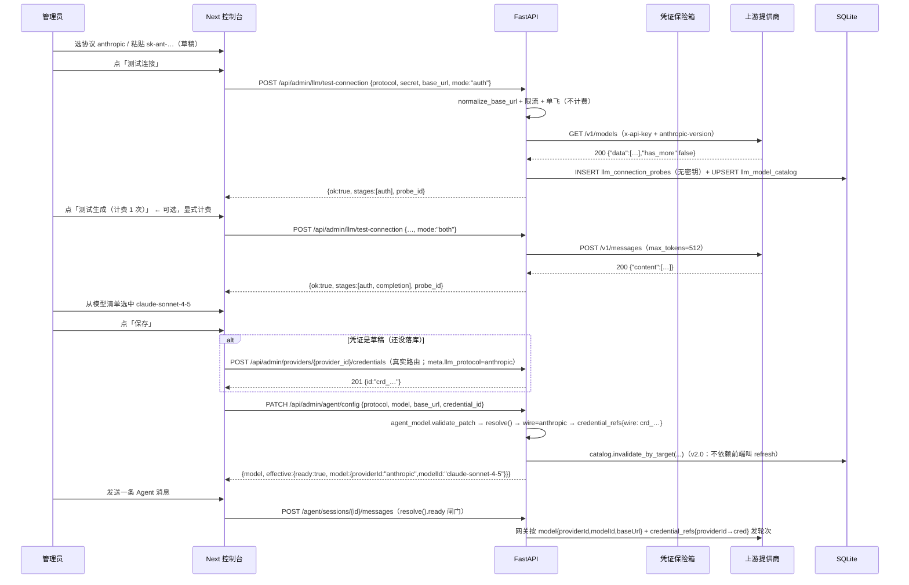

# Skill Router LLM 服务配置（四协议 · 实时连通 · 一键取模型）实现契约 v2.0

| 项 | 值 |
|---|---|
| 文档版本 | **v2.0**（本文件即实现契约；实现不得偏离，偏离需在 `implementation-notes.md` 登记） |
| 文档状态 | **可实施**（v2.0 已按 `## 评审记录` 关闭全部 P0/P1；P2 保留为建议，不阻塞实施） |
| 版本变更 | v1.0 → **v2.0**：设计评审（Anthropic 工程口径）逐节核对代码实测，修掉 3 个 P0 + 11 个 P1，详见 `## 评审记录`；结论见 `## 评审结论` |
| 目标需求 | 「LLM 配置需要完善优化：支持 openai / anthropic / google / 自定义四种 API 规范；凭证与 LLM 配置时能实时连接测试；连接测试时一键获取该凭证全部可用模型并让用户选择。要求美观、优雅、顶级设计，符合人机交互最佳实践；稳健、可靠、顶级。」 |
| 适用形态 | **网页端（Next.js 控制台）+ 同时存在的 Electron 桌面端**（两者共用同一套 API 与页面，不新增第二套真相源） |
| 生产者 | 设计节点（node #0，round 1） |
| 复审者 | 设计评审节点（Anthropic 工程口径，round 1 → v2.0）：逐节核对 `apps/api` / `apps/web` / `agents/aragon-gateway` 实测代码 |
| 消费者 | 实现 / 测试 / 验收 / 复审节点，以及后续维护者 |
| 交付物 | `docs/plans/llm-provider-config/spec.md`（本文件）；实现后交付 4 个协议规范 + **4 个 `/llm/*` 新端点 + 1 个 `credentials/{id}/models`** + 2 张新表 + `/settings/agent` 页面重构（v2.0 修正端点数：v1.0 写「3 个」，与 §5.1–5.4 的四个端点不符） |
| 相关既有契约 | [`docs/plans/skill-router/spec.md`](../skill-router/spec.md)（表名 / 路由 / 错误码以它为准，本文件**增量扩展**，不覆盖）；[`../desktop-electron/spec.md`](../desktop-electron/spec.md)（桌面端不变量） |
| 证据口径 | 沿用仓库规则：**没有证据不许写「已验证」**。本文件每条验收都要给出命令 + 输出 + 时间 + 环境，登记进 `docs/runbook/verification-report.md` |

---

## 评审记录（v2.0 设计评审）

**评审方式**：逐节读 v1.0，把每条「代码现状」与「设计结论」拿实测代码核对（不采信文档自述）。核对过的证据点：`services/agent_model.py`（`PROVIDER_IDS` / `resolve()` / `validate_patch()` / `_probe_request()` / `check()`）、`services/credentials.py`（`materialize` / `_PUBLIC_META_KEYS` / `_SENSITIVE_META` / `_sealed_meta`）、`services/credentials_verify.py`（`PROBES` / `client_kwargs` 用法）、`security/netpolicy.py`、`executors/auth.py`、`errors.py`（`Code` / `REGISTRY`）、`settings.py`、`migrations/versions/0003_iteration2.py`、`models/providers.py`、`tests/fixtures/fake_upstream.py`、`tests/test_api_contract.py`、`apps/web/app/(app)/settings/agent/page.tsx`、`apps/web/app/(app)/providers/[id]/page.tsx`、`apps/web/styles/tokens.css`、`agents/aragon-gateway/src/engine.ts`、`apps/api/pyproject.toml`、`Makefile`、`deploy/Dockerfile.api`；并用 `pytest --collect-only` 实测后端用例基线 = **285**。

**判级口径**：P0 = 照 v1.0 直接实现会**静默走错/做不出来**；P1 = 会导致回归、返工或验收门失效，必须在实施前定稿；P2 = 可读性/健壮性/范围建议，不阻塞。

| # | 严重度 | 维度 | 问题（v1.0 原文位置） | 处置 |
|---|---|---|---|---|
| R-01 | **P0** | 可行性 | 「自定义」协议下 `credential_refs` 的键没定。§3.6 只把 `model_ref.providerId` 改成 `wire`，`credential_refs` 仍隐含用协议名做键。网关 `engine.ts:846` 是 `const providerId = model.providerId; const ref = refs[providerId]` —— 键必须是 `wire`（`openai`），否则每次轮次都 `no credential_ref for provider "openai"`，「自定义」永远不可用 | v2.0 §3.6 新增硬规则 + §5.6 补 custom 响应示例 + T-32 |
| R-02 | **P0** | 完整性 | 草稿凭证**怎么落库没定义**。§3.9 时序写 `POST /api/admin/credentials` —— **该路由不存在**；真实是 `POST /api/admin/providers/{provider_id}/credentials`（`api/admin/providers.py:82`），且 `credentials.create_credential(provider_id, …)` 必须给 `provider_id`。新表单里只有「协议」，没有「提供商」概念，于是「新建凭证(草稿)」测通之后无法保存，也没有任何地方写入 `meta.llm_protocol` | v2.0 §3.3.1 明确「保存」只有一条落库路径，§3.8 ② 明确 `/settings/agent` 只做「选已有凭证 / 测草稿」，新建凭证引导到 `/providers/{id}`；时序图改为真实路由 |
| R-03 | **P0** | 一致性 | 默认 `mode` 三处互相矛盾：§3.4「`mode="both"`（默认）」、§5.2 请求表「`mode` 默认 `auth`」、§8 R1「默认 `mode=auth`（不计费）」。这条直接决定**主按钮是否花用户的钱**，且 §3.8 ③ 只有两个按钮（测试连接 / 获取模型列表）却要求渲染 `completion` 阶段——不存在触发它的入口 | v2.0 §3.4 用一张「入口 → mode → 是否计费」表把它钉死；§3.8 ③ 补第二个按钮；§5.2 默认值改 `auth`；ADR-9 |
| R-04 | **P1** | 一致性 | 传输层绕过既有出站策略。`netpolicy.client_kwargs(url)` / `trust_env_for(url)` 是仓库唯一约定的 `trust_env` 判据（`credentials_verify.py:78-84` 正在用），v1.0 §3.4 却写「`trust_env=True` 一次 → 失败再 `trust_env=False` 重试」。后果：桌面端/自托管（本机 18100、`127.0.0.1`、单标签内网名）**每次探测都先吃一次代理失败**再回退，耗时翻倍；`credentials_verify` 现有「本地目标从不过代理」的行为被反向回归 | v2.0 §3.4 传输策略改写为「先 `client_kwargs`，只在外部主机且网络类异常时才直连回退一次」；T-09 同步 |
| R-05 | **P1** | 一致性 | 认证头**第二份实现**。`executors/auth.build_auth_headers()` 已实现 `api_key` / `bearer` / `basic` / `header`（`SUPPORTED` 就是这四值），v1.0 §3.1 又让 `protocols.build_auth_headers(identity)` 自己造一遍 —— 这正是它自己 INV-1 要消灭的形态；且新增的 `auth_style="none"` 与既有 `auth_type` 命名不一致却没说映射 | v2.0 §3.1 规定 `protocols.build_auth_headers` **必须委托** `executors.auth`，只补协议级头（`anthropic-version` / `content-type`），`none` 在 protocols 内单独短路（不改 `executors`）；T-04 加断言 |
| R-06 | **P1** | 一致性 | 错误码数量与状态码双错。实测 `UPSTREAM_AUTH` / `UPSTREAM_TIMEOUT` / `UPSTREAM_UNAVAILABLE` / `UPSTREAM_INVALID_RESPONSE` / `SSRF_BLOCKED` / `VALIDATION_FAILED` / `NOT_FOUND` / `CREDENTIAL_DISABLED` **全部已存在**，真正新增的只有 `LLM_PROTOCOL_UNSUPPORTED` 与 `LLM_PROBE_THROTTLED` **2 个**，v1.0 §4.2/§7.1 T-31/§8 R8 却写「5 个」；同时 `UPSTREAM_UNAVAILABLE` 在 §3.5/§5.3 写 **502**、§5.2 写 **503**，而 `errors.py:137` 是 **503** | v2.0 §4.2 改为「2 个新码 + 8 个复用码（附状态码表）」；§3.5/§5.3 的 502 → 503；T-31 改口径 |
| R-07 | **P1** | 可行性 | `apps/api/tests/fixtures/fake_upstream.py` **已存在**（`FakeUpstream` + `patch_httpx` + `count()`，且已对 `/probe` 回 `{"data":[{"id":"fake-model"}]}`），v1.0 §4.1 把「新增四个协议形状的假上游」列成 **新文件**；§7.3 又叫用户 `python -m tests.fixtures.fake_upstream --protocol anthropic --port 18901`，而现有模块**没有 `__main__`**，这条命令今天直接失败 | v2.0 §4.1 改为「**扩展**既有文件：新增 `FakeLlmUpstream` + CLI」；§7.3 与 §4.1 对齐 |
| R-08 | **P1** | 完整性 | `protocol=custom` 且 `base_url` 为空时，`agent_model._pick_credential()` 的打分全为 0 → 返回**第一个** active 凭证（`best_score` 初值 -1，首个 0 分即中选）。于是「自定义」会静默拿一条不相干提供商的凭证去发轮次 | v2.0 §3.6 新增：`protocol=custom` 时必须「显式 `credential_id`」或「`base_url` 命中该凭证的提供商地址」，否则 `problems` 明确报错；T-33 |
| R-09 | **P1** | 一致性 | 探测超时从既有 45s 降到 20s。`agent_model.PROBE_TIMEOUT_S = 45.0` 是**为思考型模型留的**（模块注释写明「512 足以容纳简短思考」），v1.0 把统一超时设为 20s 并让 `check()` 改委托新引擎 → 既有 `POST /agent/config/test` 对 glm/o1 这类模型会**新增超时失败**（INV-4 回归） | v2.0 §3.4 分阶段超时：`auth` 走 `llm_probe_timeout_s`（20），`completion` 走 `llm_completion_timeout_s`（**45**，沿用既有值）；§4.2 补两个 setting |
| R-10 | **P1** | 完整性 | `custom` 的 `paths` 默认值不随 `wire` 继承。§3.1 表把 custom 的取模型/完成路径固定成 `models` 与 `chat/completions`，但 `wire` 允许选 `anthropic`/`google`。于是 `custom + wire=anthropic` 会 `POST {base}/chat/completions` 带 Anthropic 请求体 → 必然失败，或要用户手填路径覆盖 | v2.0 §3.1 新增「`paths` 未显式给出时**继承所选 wire 的路径**，用户给了才覆盖」；T-34 |
| R-11 | **P1** | 完整性 | 目录失效时机不全。§3.5 只在 `replace_secret`/`rotate`/`set_status(disabled)` 后 `invalidate`，且 `PATCH /agent/config` 改 `protocol/base_url/credential_id` 时**依赖前端主动 `refresh=true`**。`PATCH /credentials/{id}` 改 `meta.llm_protocol`/`base_url`、以及 curl/CLI/脚本调用方都不会触发 → 旧清单被当成新地址的清单展示 | v2.0 §3.5 把失效点改为「凭证写路径全覆盖（含 `update_credential`）」，并明确「后端在 `resolve`/`probe` 前校验 `dedupe_key`，键不匹配即视为未命中」 |
| R-12 | **P1** | 完整性 | 「选模型」与「协议/凭证」没有一致性校验。§3.8 ④ 选中模型只写 `agent_model.model`；§3.6 的 `warnings` 只覆盖「模型不在目录里」。用户可以先选 `protocol=openai`、再从**草稿 anthropic 清单**里挑 `claude-sonnet-4-5` 保存 → `effective.ready=true`（绿色「就绪」）但每一轮必然 `TURN_CONFLICT`，正是 INV-2「禁止假成功」要禁止的状态 | v2.0 §3.6 把「模型不属于当前协议的可识别家族」升为 **`problems`**（不是 `warnings`），因此 `ready=false`；§3.8 ⑤ 与「状态诚实」行同步；T-35 |
| R-13 | **P1** | 一致性 | 验收门自相矛盾。§7.4 要求 `pytest ≥ 318`，而基线实测 **285**、§4.1 计划新增 ≈58 例（20+14+12+12）→ 应为 **≥ 343**；另 INV-4 写「11 项 Playwright」，实测 `apps/web/e2e` 是 **13** 条（1+4+1+3+4） | v2.0 INV-4 与 §7.4 改为实测值（285 / 13），DoD 改 `≥ 343` |
| R-14 | **P1** | 完整性 | ⑥「探测历史」说「可点开看同一 `probe_id` 的完整阶段」，但没有 `GET /llm/probes/{probe_id}` 端点（§5.5 只有列表）。要么补端点，要么说清「列表已带全量 `stages`」 | v2.0 §3.8 ⑥ / §5.5 明确：列表项**已含完整 `stages`**，`probe_id` 只作日志/工单关联用，**不新增详情端点**（避免为一次点击多开一条路由） |
| R-15 | P2 | 右尺寸 | 范围偏重：2 张新表 + TTL + 降级 + 限流 + 单飞 + 审计 + 留存 + 6 个新组件 + 4 条新路由，而需求是「四协议 + 实时测试 + 一键取模型」。「⑥ 探测历史」与 `ProbeHistory.tsx` 是最可延后的一项 | 保留（ADR-2/ADR-7 已论证缓存与历史的生命周期），但 §9 实施顺序把 ⑥ 排到前端最后一步，允许单独回滚；不额外扩面 |
| R-16 | P2 | 一致性 | `compose_url` 的 R3 分支不可达（单段 path 时 R1 已先命中），R2 在单段 path 下会产出尾斜杠；规则里留死分支会让实现者照着写出无效断言 | v2.0 §3.2 删掉 R3，并在 R2 上加 `len(path_segments) > 1` 前置；T-01 增一行边界 |
| R-17 | P2 | 完整性 | Google 的 `nextPageToken` 分页没处理（只写了 anthropic `has_more` 续页）。`pageSize` 上限 1000 通常够，但行为应当写明是「不续页」而不是遗漏 | v2.0 §3.5 显式写「Google 不续页（`pageSize=1000` 上限内一次取完），`truncated` 只反映 `limit` 截断」 |
| R-18 | P2 | 一致性 | 限流与单飞都在**进程内**：`api` 与 `worker` 是两个进程，多 worker 部署时配额会按进程放大。v1.0 未声明前提 | v2.0 §3.4 注明「进程内状态，前提是单 uvicorn 进程；跨进程精确配额列入 §10 待验证」 |
| R-19 | P2 | 一致性 | 前端两套状态容器：`/providers/[id]` 的凭证抽屉用 `react-hook-form + zodResolver`（`credentialSchema` 在 `providers/[id]/page.tsx:28`），v1.0 又要塞一个基于 `useState` 的 `useLlmDraft` 进去 → 同一份 `secret/base_url` 两处真相 | v2.0 §3.8 补一条「抽屉内以 RHF 为唯一表单状态，`useLlmDraft` 只接受受控值 + 回调」 |
| R-20 | P2 | 一致性 | `_PUBLIC_META_KEYS` 加 `llm_paths` 会让它出现在**每一条**凭证列表项里（`/credentials` 默认 20 条、`/settings/agent` 拉 100 条），体积与信息面无收益 | §3.3 保留 `llm_protocol`/`api_version`，`llm_paths` 改为**只随单条凭证详情返回**（`get_credential`），不进 `_brief` |
| R-21 | P2 | 完整性 | 暗色主题完全没提：`apps/web/styles/tokens.css` 有 `[data-theme='dark']`，E-05 只验默认主题 | §7.2 E-05 增一条暗色断言（仅用 tokens 时天然成立，但要有证据） |
| R-22 | P2 | 一致性 | DoD 写「`mypy`（services 为 strict）」，实测 `pyproject.toml` 是 `disallow_untyped_defs = false` + `check_untyped_defs = true`，**没有** strict 覆盖（`Makefile` 注释也还是旧的）；`make lint-py` 还会跑 `ruff format --check`，v1.0 只写了 `ruff` | §7.4 按实测配置改写并补 `ruff format --check` |
| R-23 | P2 | 完整性 | 凭证不可用的错误路径没进 §5.2 错误清单：`materialize()` 会对非 active 凭证抛 `CREDENTIAL_DISABLED`(409)、对不存在抛 `NOT_FOUND`(404)。前端若不渲染这两个码，用户只会看到「测试请求失败」 | §5.2 错误清单补齐两码，并明确「非 2xx 也必须在 ③ 渲染人话」 |
| R-24 | P2 | 健壮性 | 429 退避只写「退避 0.4s 后重试一次」，没提 `Retry-After`；对真实限流的上游这是二次伤害 | §3.4 改为「有 `Retry-After` 则取 `min(Retry-After, 5s)`，否则 0.4s」 |
| R-25 | P2 | 一致性 | §3.1 的 `ProtocolSpec` 缺 `models_paginate` / `auth_none_supported` 等实现必需字段，`models_params` 用 `dict[str,str]` 无法表达 google 的 `pageSize` 与 anthropic 的 `limit` 差异（已能表达，但缺「是否分页」开关） | §3.1 字段表补 `paginate` 与 `auth_extra_headers`，避免实现时各自补字段 |

**统计**：P0 = 3（R-01/02/03），P1 = 11（R-04…R-14），P2 = 11（R-15…R-25）。全部 P0/P1 已在 v2.0 正文关闭（下表「处置」列即落点）；P2 中标「已改」的顺手修掉，其余保留为实施期建议。

---

## 0. 阅读方式、口径与不变量

本文件只解决一件事：**把「LLM 上游怎么配」从「一个下拉框 + 一个手填模型名」升级成「选协议 → 填凭证/地址 → 立刻验证 → 从真实模型清单里挑」的闭环，并且这个闭环在四套 API 规范（OpenAI / Anthropic / Google / 自定义）上行为一致、结果可复现、失败可解释。**

实现者请把下面五条当作硬不变量（违反任何一条都算缺陷，不是风格问题）：

- **INV-1 单一协议真相源**：四种协议各自的地址拼接、认证头、取模型路径、探测载荷，**只允许**定义在 `apps/api/skillrouter_api/services/llm/protocols.py`。前端**不得**硬编码协议差异（只能渲染 `GET /api/admin/llm/protocols` 的返回）；后端其它模块**不得**再写第二份 `if protocol == "anthropic": ...`。
- **INV-2 禁止假成功**：任何「已连接 / 可用 / 通过」的徽标，背后必须有一次**真实 HTTP 请求**的 2xx + 可识别响应形状；`200` 但响应体不是该协议的完成/清单结构，一律判失败并说明原因（沿用 `services/agent_model.py::_looks_like_completion` 的既有判据，扩展到模型清单）。
- **INV-3 密钥零落库零落日志**：草稿测试（用户还没保存凭证就点「测试连接」）用到的明文密钥，只允许存在于**本次请求的进程内存**中；不得写入 `credentials`、不得写入探测历史、不得进入日志 / `audit_logs` / 错误体。落库的只有掩码、指纹与脱敏后的上游响应片段。
- **INV-4 不破坏既有契约**：`agent_model` 设置里历史键（`provider` / `model` / `base_url` / `credential_id` / `temperature` / `max_tokens` / `allowed_providers` / `max_cost_usd_per_flow` / `max_test_calls_per_flow` / `allowed_window_hours`）继续可读可写；`POST /api/admin/agent/config/test`、`POST /api/admin/agent/connectivity` 的响应字段**只增不改**，且语义不变（`/agent/config/test` 仍是「打一次生成请求」）；既有基线 **285 项后端测试**（`cd apps/api && python -m pytest tests --collect-only -q` 实测合计 285）、**70 项 `e2e_live`**、**9 项 `check_web`**、**13 项 Playwright**（`apps/web/e2e` 实测 1+4+1+3+4）**保持全绿**。（v2.0 修正：v1.0 写的「11 项 Playwright」是错的，见 R-13。）
- **INV-5 桌面端不改代码**：Electron 侧只是把 `127.0.0.1:18100` 的同一套 FastAPI + 同一套 Next standalone 包起来（`apps/desktop` INV-1）。本设计**不新增**任何需要桌面端改动的东西——新端点走同源 `/api` 反代，新表随迁移自动建。

### 0.1 需求口径解码（这四条读法决定实现边界）

| 需求原文 | 本设计的读法 | 不做什么 |
|---|---|---|
| 支持 openai / anthropic / google / 自定义「四种形式的 API 规范配置」 | 四种 = 四个**线协议预设**：`openai`（Chat Completions + `/models`）、`anthropic`（Messages + `/v1/models`）、`google`（generateContent + `/v1beta/models`）、`custom`（自定义地址 + 可选线协议 + 可覆盖路径/认证头）。`custom` 不是「随便发一个 HTTP」，而是「地址与路径可改、线协议仍是三者之一」 | 不做任意 JSON 路径映射 DSL、不做 Azure deployment 自动推导、不做 Vertex AI 的 OAuth2 服务账号（列入 §8 风险与 §10 待验证） |
| 「凭证和 LLM 配置的时候，就能够实时进行连接测试」 | 两个入口都支持**未保存先测**：①`/providers/{id}` 新建凭证抽屉；②`/settings/agent` 的配置表单。测试用**当前表单值**（草稿），不是「必须先保存」——旧页面那句「测试打的是已保存的配置」正是本轮要消灭的可用性缺陷 | 不做后台定时巡检（已有 `credentials_verify.verify_pending`，本轮不动） |
| 「连接测试的时候，能够根据用户配置的凭证，一键获取所有可用模型，并让用户选择」 | 一次点击 = 一次真实 `GET 模型清单` → 归一化成 `{id, display_name, kind, recommended, context_window}` → 写入目录缓存 → 前端搜索选择器选中后写回 `agent_model.model`（未保存时是表单草稿值） | 不做模型价格/能力自动探测（价格仍由 `price_book` 手工维护） |
| 「Anthropic 的顶级产品」 | 双重含义都覆盖：① **协议级**——Anthropic Messages API 的支持要到「能和 Anthropic 官方控制台打出一样的结果」的程度（`anthropic-version`、`x-api-key`、`/v1/models` 分页、`max_tokens` 必填、`stop_reason` 识别）；② **体验级**——控制台观感与文案向 Anthropic 自己的产品看齐：克制的配色、明确的层级、无隐藏状态、失败必有人话解释 | 不实现 Claude 专属的 prompt caching / batch API / files API（与「配置 LLM」无关） |

---

## 1. 概述（Overview）

Skill Router 现在的 LLM 配置是**一个下拉框 + 两个文本框**：`/settings/agent` 让人从 `anthropic / openai / google` 里选一个「协议族」，手填模型名、手填 `base_url`、从全局凭证列表里挑一个凭证，然后点「测试连通性」。这条路径在真实使用中暴露了四个问题。第一，**自定义上游无路可走**：任何 OpenAI 兼容网关（vLLM、LiteLLM、One-API、企业自建聚合网关）都只能靠「选 openai + 手填地址」蒙过去，而地址里到底该不该带 `/v1`、路径是不是 `chat/completions`，全靠人猜。第二，**模型名靠背**：用户必须事先知道上游的 exact model id，填错只会在发消息时以 `TURN_CONFLICT` / 400 的形式炸出来。第三，**测试必须先保存**：页面明确写着「测试打的是已保存的配置，请先点保存」，于是「试一下这个 key 对不对」变成「先污染一次配置再试」。第四，**默认探测对协议不友好**：`services/credentials_verify.py` 对 `llm` 类凭证一律 `GET {base_url}/models`，Anthropic 的真实端点是 `GET {base_url}/v1/models` 且必须带 `anthropic-version`，Google 是 `GET {base_url}/v1beta/models` 且用 `x-goog-api-key` ——**这些凭证会被平台误判为无效**，是本轮必须一起修掉的既有缺陷。

本轮要建的是**一个协议注册表 + 一个探测引擎 + 一个模型目录 + 一次页面重构**。协议注册表（`services/llm/protocols.py`）把四种规范各自的默认地址、版本段、取模型路径、认证头、完成请求形状收敛成数据；探测引擎（`services/llm/probe.py`）用同一套身份描述（保存的凭证 **或** 未保存的草稿密钥）跑「两阶段探测」——阶段 `auth` 拉模型清单（不计费）→ 阶段 `completion` 打一次最小生成（计费，可选）；模型目录（`services/llm/models_catalog.py`）把上游返回的各种形状归一化、按用途分类、按「是否推荐」排序，并落 `llm_model_catalog` 表做 TTL 缓存与**失败时的降级读旧值**。前端把 `/settings/agent` 重构成一条「协议卡片 → 连接信息 → 实时验证 → 模型选择 → 生效引用」的渐进式表单，并把同一个「先测再存」的体验搬进新建凭证抽屉，所以「配 LLM」和「配凭证」两条路都不会再出现「保存了才知道错」。

这件事的技术难点不在「多写几个 HTTP 调用」，而在**三个不变量的同时成立**：同一份配置要在 API 侧（探测、取模型）与网关侧（真正发轮次）被解释成**同一个地址与同一个协议族**；草稿密钥要在「能发真实请求」与「绝不落库落日志」之间取平衡；上游返回的模型清单要在四种形状（`data[]` / `models[]` / `models/xxx` 前缀 / 分页 `has_more`）之上给出**一个**前端契约，并且在上游抖动时不让用户看到「一个模型都没有」。因此本设计把「URL 拼接与归一化」写成带 6 个例子的确定性规则（§3.2），把「草稿身份」写成一个可测的 `ProbeIdentity`（§3.3），把「清单归一化 + 缓存 + 降级」写成一条有明确优先级的状态链（§3.5）。这套东西必须能在**没有任何第三方密钥**的机器上被验证：`scripts/check_llm_protocols.py` 会起四个本地假上游，把 4 协议 × 3 阶段的全矩阵打成一张表，作为本轮唯一可信的自动化证据。

---

## 2. 现状盘点（为什么必须改，证据在哪）

| 现状 | 文件 / 行 | 问题 |
|---|---|---|
| 协议族只有三个 | `apps/api/skillrouter_api/services/agent_model.py:39` `PROVIDER_IDS = ("anthropic","openai","google")` | 无 `custom`；`PATCH /agent/config` 对 `provider=custom` 直接 `VALIDATION_FAILED`（`validate_patch` 第 241-248 行） |
| 网关 provider 与「协议族」混为一谈 | 同上 `resolve()` 第 200 行 `model_ref = {"providerId": provider_kind, ...}` | `custom` 无法表达「用户自定义地址 + 走 OpenAI 线协议」 |
| 模型名只能手填 | `apps/web/app/(app)/settings/agent/page.tsx:457-471` | 无候选、无校验、无搜索；错一个字只能等发消息时炸 |
| 测试必须先保存 | 同上 `page.tsx:541-550` | 「测试打的是已保存的配置，请先点保存」——直接违背「实时连接测试」的需求 |
| 凭证有效性探测对协议无感 | `services/credentials_verify.py:18-25` `PROBES["llm"] = ("GET","{base_url}/models",None)` | Anthropic / Google 会被误判；认证头也只有 `api_key/bearer/basic/header` 四种通用形态，缺 `x-goog-api-key` 与 `anthropic-version` |
| 探测只回一个布尔 | `services/credentials_verify.verify()` | 没有「阶段」概念，无法区分「鉴权通过但模型名写错」 |
| 无模型目录 | 全仓无 `catalog` 相关表 | 每次都要重新打上游；上游抖动时页面空白 |
| `agent_model.check()` 的探测地址写死 | `services/agent_model.py:327-358` `_probe_request()` | 与 `credentials_verify` 是**第二份**协议实现（INV-1 违反），且不含 `custom` |
| 前端模型/凭证二选一 | `page.tsx:216-233` | 只能从「前 100 条凭证」里选；新建凭证必须跳页 |

> 结论：本轮不是「加一个下拉项」，而是把 LLM 上游配置**收口成一套协议注册表**，并把「测试 / 取模型 / 选模型 / 保存」串成一条不产生第二个真相源的流水线。

---

## 3. 技术设计

### 3.1 协议注册表（唯一真相源）

新增模块 `apps/api/skillrouter_api/services/llm/protocols.py`。

```python
@dataclass(frozen=True, slots=True)
class ProtocolSpec:
    key: str                       # openai | anthropic | google | custom
    label: str                     # 英文名（代码/日志里用）
    label_zh: str                  # 界面文案
    one_liner: str                 # 卡片一句话
    wire: str | None               # 网关 providerId：openai|anthropic|google；custom 为 None（用户选）
    default_base_url: str          # 空串表示必须用户填写
    base_url_hint: str             # 输入框 placeholder + 帮助文案
    docs_url: str
    auth_styles: tuple[str, ...]   # bearer | api_key | basic | header | none（见下方映射表）
    default_auth_style: str
    version_header: tuple[str, str] | None   # 例：("anthropic-version", "2023-06-01")
    auth_extra_headers: dict[str, str]       # 认证阶段必须附加的非密钥头（例：{"content-type": "application/json"}）
    strip_version_suffix: str | None         # 归一化时从 base 尾部剥离的段：anthropic="v1"，google="v1beta"
    models_path: str               # 取模型清单的路径（相对 base 或绝对，见 §3.2）
    models_params: dict[str, str]  # 例：anthropic {"limit": "1000"}；google {"pageSize": "1000"}
    models_array: str              # 响应里模型数组的键：data | models
    model_id_field: str            # id | name
    model_name_field: str          # display_name | displayName | id
    chat_path: str                 # 完成请求路径模板（可含 {model}）
    chat_body: str                 # openai | anthropic | google
    paginate: str | None           # 续页方式：None（不续页）| "anthropic_after_id" | "google_next_page_token"
    supports_models_list: bool
```

| 协议 | wire | 默认 base_url | 取模型 | 完成请求 | 认证 | 归一化剥离 |
|---|---|---|---|---|---|---|
| `openai` | `openai` | `https://api.openai.com/v1` | `GET {base}/models` | `POST {base}/chat/completions` | `Authorization: Bearer` | —（base 保留 `/v1`） |
| `anthropic` | `anthropic` | `https://api.anthropic.com` | `GET {base}/v1/models?limit=1000` | `POST {base}/v1/messages`（必带 `max_tokens`） | `x-api-key` + `anthropic-version: 2023-06-01` | 尾部 `v1`（用户贴 `…/v1` 也能用） |
| `google` | `google` | `https://generativelanguage.googleapis.com` | `GET {base}/v1beta/models?pageSize=1000` | `POST {base}/v1beta/models/{model}:generateContent` | `x-goog-api-key` | 尾部 `v1beta` |
| `custom` | 用户选（默认 `openai`） | 空（必填） | `GET {base}{paths.models}`（**默认继承 wire**，见下） | `POST {base}{paths.chat}`（**默认继承 wire**） | 用户选（默认 `bearer`） | 不剥离（由用户自负，`normalize` 只做 `rstrip('/')` 与协议校验） |

**`custom` 的 `paths` 必须继承所选 `wire`（v2.0 新增，R-10）**：`custom` 只覆盖「地址与路径可改」，**不改变线协议语义**。因此 `paths` 未显式给出时，`models` / `chat` 取 **`wire` 那个协议的值**，而不是固定取 openai 的：

| `custom` 的 wire | 默认 `paths.models` | 默认 `paths.chat` |
|---|---|---|
| `openai` | `models` | `chat/completions` |
| `anthropic` | `/v1/models` | `/v1/messages` |
| `google` | `/v1beta/models` | `/v1beta/models/{model}:generateContent` |

用户显式给了 `paths.models` / `paths.chat` 才覆盖。**否则 `custom + wire=anthropic` 会 POST 到 `/chat/completions` 带 Anthropic 请求体，必然失败**（v1.0 的固定默认值是这个 bug 的来源）。

**`auth_style` → 既有 `auth_type` 的映射（v2.0 新增，R-05）**：`executors/auth.py` 的 `SUPPORTED = ("api_key","bearer","basic","header")` 是仓库唯一实现，**不得复制**：

| `auth_style`（本设计对外） | 落到 `executors.auth.build_auth_headers` 的 `auth_type` | 实际头 |
|---|---|---|
| `bearer` | `bearer` | `Authorization: Bearer <secret>` |
| `api_key` | `api_key` + `header_name`（默认按协议：`x-api-key` / `x-goog-api-key` / `X-API-Key`） | `<header_name>: <secret>` |
| `basic` | `basic`（`meta.username` 或 `secret` 里的 `user:pass`） | `Authorization: Basic …` |
| `header` | `header` + `header_name` | 自定义头名（企业网关） |
| `none` | ——（**不调用** `executors.auth`，返回空字典） | 无认证（内网免鉴权网关） |

`none` 只在 `protocols.build_auth_headers()` 内短路，**不修改** `executors/auth.SUPPORTED`（`executors` 不在本轮改动清单里，见 §4.2）。

对外暴露：

```python
PROTOCOL_KEYS: tuple[str, ...] = ("openai", "anthropic", "google", "custom")
WIRE_KEYS: tuple[str, ...] = ("openai", "anthropic", "google")

def get(protocol: str) -> ProtocolSpec: ...        # 未知名 → ApiError(LLM_PROTOCOL_UNSUPPORTED)
def public_catalog() -> list[dict]: ...             # GET /api/admin/llm/protocols 的 items
def wire_of(protocol: str, override: str | None) -> str: ...
def effective_paths(protocol: str, wire: str, override: LlmPaths | None) -> LlmPaths: ...
    # v2.0 新增：custom 未给 paths 时继承 wire 的默认值（见上表），其它协议忽略 override
def normalize_base_url(protocol: str, raw: str, *, wire: str | None = None) -> tuple[str, list[str]]: ...
def compose_url(base_url: str, path: str, query: dict[str, str] | None = None) -> str: ...
def build_auth_headers(identity) -> dict[str, str]: ...   # 必须委托 executors.auth.build_auth_headers（R-05）
def build_models_request(spec, identity) -> tuple[str, str]: ...           # (method, url)
def build_chat_request(spec, identity, model: str) -> tuple[str, dict]: ...# (url, body)
def parse_models(spec, payload: dict) -> list[ModelEntry]: ...
def looks_like_completion(spec, payload: dict) -> bool: ...
def extract_text(spec, payload: dict) -> str: ...
```

> **`agent_model.py` 的 `_probe_request` / `_looks_like_completion` / `_extract_text` 一并迁到这里**，`agent_model` 改为调用它们（保留同名薄封装以免破坏既有测试）。这是 INV-1 的落地动作，不是可选项。

### 3.2 URL 归一化与拼接规则（8 个例子的确定性行为）

用户会贴出**八种**形态的 base_url（含 `custom` 的两种），必须全都得到同一个正确结果：

```python
def normalize_base_url(
    protocol: str, raw: str, *, wire: str | None = None
) -> tuple[str, list[str]]:
    notes: list[str] = []
    url = (raw or "").strip()
    if url == "":
        return "", notes
    validate_admin_target(url)                 # 只禁非 http(s) 与云元数据（沿用 netpolicy）
    url = url.rstrip("/")
    spec = get(protocol)
    seg = spec.strip_version_suffix
    if seg:
        tail = "/" + seg
        if url.lower().endswith(tail):
            url = url[: -len(tail)]
            notes.append(f"已从地址尾部去掉重复的版本段 /{seg}")
    # OpenAI / custom(openai wire)：host 直连（无路径）时补 /v1
    # custom 的 wire 由调用方在 resolve_identity() 里先算出来再传进来（见 §3.3）
    effective_wire = wire or (get(protocol).wire or "openai")
    if protocol == "openai" or (protocol == "custom" and effective_wire == "openai"):
        parsed = urlparse(url)
        if parsed.path in ("", "/"):
            url += "/v1"
            notes.append("已按 OpenAI 规范补上 /v1")
    return url, notes
```

```python
def compose_url(base_url: str, path: str, query: dict[str, str] | None = None) -> str:
    base = base_url.rstrip("/")
    p = path if path.startswith("/") else "/" + path
    path_only, _, existing_qs = p.partition("?")
    base_segments = [s for s in urlparse(base).path.split("/") if s]
    path_segments = [s for s in path_only.split("/") if s]
    # R1 用户已经把完整路径贴进 base（…/v1/messages）→ 不重复拼接
    if path_segments and base_segments[-len(path_segments):] == path_segments:
        url = base
    # R2 base 尾部与 path 首段重合（…/v1 + /v1/models）→ 去掉 path 的重合首段
    #    前置 len(path_segments) > 1：单段 path 在上面的 R1 已必定命中，
    #    留着会拼出尾斜杠（v2.0 修正，R-16；v1.0 的 R3 分支不可达，已删）
    elif base_segments and len(path_segments) > 1 and base_segments[-1] == path_segments[0]:
        url = f"{base}/{'/'.join(path_segments[1:])}"
    else:
        url = f"{base}{path_only}"
    merged = {**dict(parse_qsl(existing_qs)), **(query or {})}
    return f"{url}?{urlencode(merged)}" if merged else url
```

| # | 协议 | 用户填的 base_url | 期望取模型 URL | 期望完成 URL |
|---|---|---|---|---|
| 1 | openai | `https://api.openai.com/v1` | `https://api.openai.com/v1/models` | `…/v1/chat/completions` |
| 2 | openai | `https://api.openai.com` | `https://api.openai.com/v1/models`（补 `/v1`） | `…/v1/chat/completions` |
| 3 | anthropic | `https://api.anthropic.com/v1` | `https://api.anthropic.com/v1/models?limit=1000`（剥 `v1` 再拼） | `…/v1/messages` |
| 4 | anthropic（自托管兼容） | `https://open.bigmodel.cn/api/anthropic` | `https://open.bigmodel.cn/api/anthropic/v1/models?limit=1000` | `…/api/anthropic/v1/messages` |
| 5 | google | `https://generativelanguage.googleapis.com/v1beta` | `…/v1beta/models?pageSize=1000` | `…/v1beta/models/gemini-2.5-pro:generateContent` |
| 6 | custom（wire=openai） | `https://gw.internal/openai` | `https://gw.internal/openai/models` | `…/openai/chat/completions` |
| 7 | custom（wire=anthropic，未给 paths） | `https://gw.internal/anthropic` | `https://gw.internal/anthropic/v1/models?limit=1000` | `…/anthropic/v1/messages`（v2.0 新增，R-10） |
| 8 | custom（wire=openai，用户已把完整路径贴进 base） | `https://gw.internal/openai/models` | `https://gw.internal/openai/models`（R1 命中，**不得**出现 `…/models/models`） | `…/openai/chat/completions`（v2.0 新增，R-16） |

**验收级要求**：这 8 行必须变成 `tests/test_llm_protocols.py::test_compose_matrix` 的参数化用例（`pytest.mark.parametrize`），且失败信息要能直接定位到行号。

### 3.3 探测身份（草稿态 vs 已保存态）

```python
@dataclass(slots=True)
class ProbeIdentity:
    protocol: str
    wire: str
    base_url: str                 # 已归一化
    auth_style: str
    header_name: str | None
    secret: str                   # 只在本对象生命周期内存在
    extra_headers: dict[str, str]
    query_params: dict[str, str]
    paths: LlmPaths | None
    credential_id: str | None
    provider_id: str | None
    source: str                   # "credential" | "draft"
    notes: list[str]              # 归一化提示（前端展示，不阻塞）

def resolve_identity(payload: ProbeTarget) -> ProbeIdentity: ...
```

解析优先级（顺序即实现顺序，不可调换）：

1. `credential_id` 给出 → `credentials.materialize(credential_id, include_sealed=True)`：
   - `protocol` 取请求值 > `credential.meta["llm_protocol"]` > 由 `provider.slug/name` 推断（`anthropic|claude`→anthropic，`google|gemini`→google，其余→openai；推断时 `notes.append("协议族由提供商名推断")` 并回 `inferred: true`）；
   - `base_url` 取请求值 > `provider.base_url` > `spec.default_base_url`；
   - `secret` 取解封后的 `secret`；`auth_style` 取 `credential.auth_type` 映射（`api_key`→按协议默认头；`bearer`→bearer；`basic`→basic；`header`→api_key + `header_name`）。
   - **`materialize()` 会抛错，必须当成可读结论**（v2.0 新增，R-23）：非 `active` → `CREDENTIAL_DISABLED`(409)；不存在/已删 → `NOT_FOUND`(404)。这两个码由全局 `ApiError` 处理器返回，前端 ③ 必须渲染 `code/message/hint`，不得只显示「测试请求失败」。
2. `secret` 直接给出（草稿）→ `credential_id` 必须为空，`base_url` 必须非空，`auth_style` 默认取 `spec.default_auth_style`。
3. 两者都给 → `VALIDATION_FAILED`（`details.fields=[{path:"secret", message:"secret 与 credential_id 只能二选一"}]`）。
4. 两者都不给 → `VALIDATION_FAILED`（"需要 credential_id 或 secret"）。

#### 3.3.1 「草稿」能测，但只有一条保存路径（v2.0 新增，R-02）

v1.0 让 `/settings/agent` 同时承担「测草稿」和「建凭证」，但**凭证表的写入入口只有一个**，且签名带 `provider_id`：

```
POST /api/admin/providers/{provider_id}/credentials   # 真实路由（api/admin/providers.py:82）
services.credentials.create_credential(provider_id, data, *, actor)   # 必须有 provider_id
```

`/settings/agent` 的表单里**没有**「提供商」概念（协议 ≠ 提供商：一个 Anthropic 提供商下可以有多张凭证，而「自定义」可能根本没有对应提供商行）。因此本设计定死：

| 场景 | 行为 |
|---|---|
| ② 选「已有凭证」 | 直接 `credential_id` → 测试/取模型都走它 |
| ② 选「草稿（临时密钥）」 | **只用于测试与取模型**；③ 的结果里回 `credential_suggestion = {name, protocol, base_url}`（建议名，不落库）；② 下方给**主按钮跳转** `/providers/{id}?createCredential=1&protocol=<protocol>`，抽屉里预填协议与地址，保存后回到本页 |
| 用户想「就在这里保存凭证」 | **不支持**，且这是刻意的：凭证必须挂在提供商下（`CREDENTIAL_IN_USE`/`impact` 都要按提供商算关联），在设置页凭空建提供商会让「提供商 → 凭证 → 能力」的既有模型出现孤儿行 |
| 写 `meta.llm_protocol` 的唯一入口 | `POST/PATCH /credentials` 的 `meta`（`_partition_meta` 走白名单，`llm_protocol` 明文、`extra_headers` 密封）；`/settings/agent` **不写**凭证的 meta |

> 结论：需求里的「凭证和 LLM 配置的时候就能实时连接测试」由**两个入口共享同一个探测端点**满足；**保存**永远发生在它该发生的页面（凭证抽屉）。这样既不出现第二套凭证写入路径，也不会让设置页变成一个半成品 CRUD。

**`credentials.materialize` 的改动**（唯一一处动既有函数）：

```python
def materialize(credential_id: str, *, include_sealed: bool = False) -> dict:
    ...
    meta = dict(row.meta or {})
    if include_sealed:
        meta.update(_sealed_meta(row))     # extra_headers / api_version 等敏感键
    return {..., "meta": meta}
```

默认 `False` → 既有调用点（`credentials_verify`、`executors`、`api/v1/callbacks`）行为**完全不变**。LLM 探测与轮次注入传 `True`。

`_PUBLIC_META_KEYS` 新增两个**可明文**的键（供前端回显，不含密钥）：`llm_protocol`、`api_version`。
`llm_paths` **不进** `_PUBLIC_META_KEYS`（v2.0 修正，R-20）：`_brief()` 会给列表里每条凭证都带一份路径对象（`/credentials` 每页 20 条、`/settings/agent` 一次拉 100 条），体积与信息面无收益；它只在 `get_credential()` 单条详情里返回。

`_ALWAYS_SEALED = {"extra_headers", "proxy_authorization"}` 加入 `_partition_meta` 的判定：命中即密封（`extra_headers` 的值可能是第二种密钥）。这条是必需的——实测 `_SENSITIVE_META` 正则 `(secret|token|passw|signature|webhook|api[_-]?key|private)` **匹配不到 `extra_headers`**，不显式登记它就会以明文进 `row.meta` 并随 `_brief()` 出到列表响应里。密封后投影只出现 `meta_redacted_keys` 里的键名——这正是既有安全模型的自然延伸，不新增泄露面。

### 3.4 探测引擎（两阶段、可解释、可限流）

新增 `apps/api/skillrouter_api/services/llm/probe.py`。

```python
AUTH_TIMEOUT_S = settings.llm_probe_timeout_s          # 20：只拉清单，短超时
COMPLETION_TIMEOUT_S = settings.llm_completion_timeout_s  # 45：沿用 agent_model.PROBE_TIMEOUT_S 的既有值
AUTH_STAGE = "auth"           # GET 模型清单：不计费
COMPLETION_STAGE = "completion"  # 最小生成：计费
PROBE_MAX_TOKENS = 512        # 沿用 agent_model.PROBE_MAX_TOKENS 的理由（思考型模型）
PROBE_PROMPT = "只回复两个字：正常"

async def test_connection(identity: ProbeIdentity, *, mode: str, model: str | None,
                          actor: str | None) -> dict: ...
async def _run_auth(identity) -> StageResult: ...
async def _run_completion(identity, model: str) -> StageResult: ...
async def _request(identity, method: str, url: str, *, json_body=None,
                   timeout_s: float) -> httpx.Response: ...
```

**分阶段超时是硬要求**（v2.0 新增，R-09）：`agent_model.PROBE_TIMEOUT_S = 45.0` 存在的原因是思考型模型（glm/o1 等）在 20s 内可能只吐了思考、没吐正文——把 `completion` 也压到 20s 会让既有 `POST /agent/config/test` 出现**新超时失败**（INV-4 回归）。`auth` 只是拉清单，20s 足够。

**三种 mode 的语义（v2.0 钉死，R-03）**：

| mode | 执行 | 计费 | 短路规则 | 谁在用 |
|---|---|---|---|---|
| `auth`（**API 默认**） | 只 `GET` 模型清单 | 否 | —— | `POST /llm/test-connection` 缺省值、`POST /llm/models`、`credentials_verify` |
| `completion` | 只 `POST` 一次最小生成（**不先拉清单**） | 是（1 次） | —— | 兼容既有 `POST /agent/config/test`：**与今天的行为逐字节等价**（今天就是一次生成请求；先插一个 GET 会让「不实现 `/models` 的网关」从可用变成不可用，见 R3） |
| `both` | `auth` → 成功才跑 `completion` | 是（1 次，且鉴权失败时为 0） | `auth` 失败即短路，`completion` 记 `未执行（鉴权未通过）` | 页面 ③ 的**第三个**按钮「测试生成（计费 1 次）」、§3.9 序列 |

`completion` / `both` 需要 `model`：请求未给则取 `agent_model` 设置里的 model，再取凭证 `meta["model"]`，都没有 → `VALIDATION_FAILED`（"完成态探测需要一个模型名"）。

**传输策略**（`_request` 内统一；**必须走 `security/netpolicy.py`，不得自造 `trust_env`**，v2.0 修正 R-04）：

```python
kwargs = client_kwargs(url, timeout=timeout_s, follow_redirects=False)  # trust_env 由 trust_env_for(url) 决定
```

1. 先按 `client_kwargs(url)` 发一次：本机/私网/单标签内网名 → `trust_env=False`（**从不过代理**）；公网 → `trust_env=True`（尊重企业代理）。
2. 仅当第 1 步**是外部主机**（`trust_env_for(url) is True`）且抛 `httpx.ConnectError / ReadError / TimeoutException` 时，才用 `trust_env=False` 直连重试 **1** 次——管理员自配的公网地址不应被坏代理误杀。本机目标不做这次重试（它本来就没走代理，重试只会把一次失败拖成两次）。
3. 5xx / 429 → 不直连重试（避免放大）；退避后重试 **1** 次：有 `Retry-After` 取 `min(Retry-After, 5s)`，否则 `0.4s`（v2.0 修正，R-24）。
4. 4xx → 不重试。
5. 全部失败 → 转成**结构化结果**（不是 500）：`ok=false, stages=[...], detail=redact(...)`。

**认证头**：`protocols.build_auth_headers(identity)` 内部**委托** `executors.auth.build_auth_headers({auth_type, secret, header_name, meta})`（R-05），再叠加 `spec.auth_extra_headers`（`content-type`）与 `spec.version_header`（`anthropic-version`）；`auth_style="none"` 直接返回 `{}`。

**限流与单飞**：进程内 token bucket，键 `credential_id or sha256(protocol|base_url)[:12]`，配额 **10 次 / 60 秒**；超出 → `ApiError(LLM_PROBE_THROTTLED)`（429，`details.retry_after_s`）。同一 `dedupe_key` 的并发请求用 `asyncio.Lock` 单飞（双击不会打两次上游）。**前提是单 uvicorn 进程**（`api` 与 `worker` 是两个进程，各自一份配额）；跨进程精确配额列入 §10 待验证，不在本轮做 Redis。

**脱敏**：`detail = redact(text, max_len=400)`，并在 `redact` 之后再显式 `text.replace(secret, "***")`（实测 `logging._PATTERNS` 只覆盖 `sk-…` / `srk_…` / `Bearer …` / `?key=` 等形态，自托管网关的 `gw-xxxx` 类自定义 key **不命中**任何模式，必须补这一刀）。落日志的请求头另走 `executors.auth.redact_headers()`，不要手写。

**结果形状**（新契约；`POST /agent/config/test` 旧字段全部保留）：

```json
{
  "ok": true,
  "protocol": "anthropic",
  "wire": "anthropic",
  "base_url": "https://api.anthropic.com",
  "resolved_url": "https://api.anthropic.com/v1/models?limit=1000",
  "mode": "both",
  "stages": [
    {"stage": "auth", "ok": true, "http_status": 200, "latency_ms": 212,
     "detail": "GET …/v1/models → 200，识别到 12 个模型", "model_count": 12},
    {"stage": "completion", "ok": true, "http_status": 200, "latency_ms": 640,
     "model": "claude-sonnet-4-5", "detail": "模型正常回话", "text_chars": 2}
  ],
  "probe_id": "llmp_9f3c1a2b7d4e",
  "checked_at": "2026-02-11T08:31:07Z",
  "problems": [],
  "credential": {"id": "crd_…", "name": "anthropic-prod", "secret_mask": "sk-…-9f2c"},
  "inferred": false,
  "notes": []
}
```

失败样例（**这是本轮体验的核心**：告诉人下一步做什么）：

```json
{
  "ok": false, "protocol": "google", "wire": "google",
  "resolved_url": "https://generativelanguage.googleapis.com/v1beta/models?pageSize=1000",
  "stages": [{"stage": "auth", "ok": false, "http_status": 403, "latency_ms": 188,
              "detail": "{\"error\":{\"code\":403,\"message\":\"API key not valid\"}}"}],
  "error_code": "UPSTREAM_AUTH",
  "hint": "上游拒绝鉴权：检查 API key 是否属于该项目，或该 key 是否启用了 Generative Language API",
  "problems": ["鉴权阶段失败，未发出计费请求"]
}
```

### 3.5 模型目录（归一化 → 分类 → 缓存 → 降级）

新增 `apps/api/skillrouter_api/services/llm/catalog.py`。

```python
@dataclass(slots=True)
class ModelEntry:
    id: str
    display_name: str
    kind: str                  # chat | embedding | audio | image | rerank | other
    recommended: bool
    context_window: int | None
    methods: list[str]         # google 的 supportedGenerationMethods；其余 []
    created_at: str | None
    owned_by: str | None

async def list_models(identity, *, refresh: bool, include_non_llm: bool,
                      limit: int = 500, actor: str | None = None) -> dict: ...
def normalize(payload: dict, spec: ProtocolSpec) -> tuple[list[ModelEntry], bool]: ...
def classify(model_id: str) -> str: ...
def is_recommended(model_id: str) -> bool: ...
```

**四种上游形状的归一化规则**：

| 协议 | 响应形状 | 抽取规则 |
|---|---|---|
| openai / custom | `{"data":[{"id","created","owned_by"}]}` | `id = row.id`；`display_name = row.name or row.id`；`created_at` 转 ISO |
| anthropic | `{"data":[{"id","display_name","created_at","type"}],"has_more":false,"last_id":"…"}` | `id = row.id`；`display_name = row.display_name or row.id`；`has_more=true` 时按 `after_id=last_id` **最多续 3 页** |
| google | `{"models":[{"name":"models/gemini-2.5-pro","displayName","inputTokenLimit","supportedGenerationMethods":[…]}]}` | `id = name` 去 `models/` 前缀；`kind = "chat" if "generateContent" in methods else "other"`；`context_window = inputTokenLimit` |
| 兜底 | `{"items":…}` / `{"result":{"data":…}}` / 顶层数组 | 按 `models_array` 找不到时依次尝试 `data → models → items → result.data`，仍找不到 → `UPSTREAM_INVALID_RESPONSE`（"上游 200 但响应里没有模型数组，可能是错误的路径"） |

**续页口径（v2.0 明确，R-17）**：`ProtocolSpec.paginate` 决定续页方式——`anthropic_after_id` 用 `has_more` + `last_id`（最多 3 页）；`google_next_page_token` **只取第一页**（`pageSize=1000` 已覆盖 Gemini 全部模型；`nextPageToken` 不续取，`truncated` 不因此置真）；`None` 不续页。三种情况都要在 `notes` 里留一句可读说明，避免「只拿到 1000 条」被误读成「上游只有 1000 个模型」。

**分类正则**（`classify`，按顺序匹配，命中即止）：`embed`→embedding；`rerank`→rerank；`whisper|transcrib|tts|speech|audio|realtime`→audio；`dall-e|image|flux|sd-?3|imagen`→image；`chat|instruct|gpt|claude|gemini|qwen|deepseek|glm|llama|mistral|kimi|doubao|o1|o3|o4`→chat；否则 other。
**推荐正则**（`is_recommended`）：`gpt-4|gpt-5|o3|o4|claude-(3|4|sonnet|opus|haiku)|gemini-(1\.5|2|3)|qwen[23]|deepseek-(v3|r1|chat)|glm-4|llama-3\.[1-3]|mistral-large|kimi-k2`。
**默认返回**：`include_non_llm=false` 时只返回 `kind in ("chat","other")`；排序 = `recommended` 降序 → `kind`（chat 优先）→ `id` 升序；`limit` 上限 500，超出置 `truncated=true`。

**缓存与降级状态链**（这是「稳健」的具体含义）：

```
refresh=True            → 直打上游 → 成功写库(upsert by dedupe_key) → source="upstream"
refresh=False, 缓存未过期 → 读库 → source="cache"
refresh=False, 缓存已过期 → 打上游 → 成功写库 → source="upstream"
                          ↘ 失败：库里还有 <24h 的旧值 → 200 + source="cache-stale" + warning
                          ↘ 失败且无旧值       → 503 UPSTREAM_UNAVAILABLE（含 upstream 脱敏摘要；状态码以 errors.REGISTRY 为准，v2.0 修正 R-06）
```

`dedupe_key = sha256(f"{protocol}|{wire}|{base_url}|{credential_id or ''}")[:32]`（SQLite 的 UNIQUE 对 NULL 视为互异，用哈希串绕开）。
TTL：`settings.llm_catalog_ttl_s`（默认 600，env `SKILLROUTER_LLM_CATALOG_TTL_S`，范围 60–86400）。

**失效时机（v2.0 补全，R-11）**——三类都会让旧行变成「别人的清单」，必须一起清：

| 触发点 | 动作 |
|---|---|
| `credentials.replace_secret()` / `rotate()` / `set_status(disabled)` | `catalog.invalidate(credential_id)`（v1.0 已有） |
| `credentials.update_credential()` 改了 `meta.llm_protocol` / `provider.base_url` / `auth_type` | `catalog.invalidate(credential_id)`（v2.0 新增） |
| `PATCH /agent/config` 改 `protocol` / `wire` / `base_url` / `credential_id` | 后端在写事务内 `catalog.invalidate_by_target(protocol, wire, base_url)`；**不依赖前端**叫 `refresh=true`（curl / CLI / 脚本调用方不会叫） |

另外，`list_models()` 在用缓存前必须重算 `dedupe_key` 并**核对命中行**：键不匹配（地址或凭证换了）就当作未命中，而不是「用这条旧行凑一个 200」。

### 3.6 `agent_model` 的协议映射（`custom` 如何变成网关能懂的东西）

`services/agent_model.py` 的改动（保持函数名与既有返回字段，只增不改）：

1. `PROVIDER_IDS` 保留（既有测试与前端 `providers` 字段仍读它），新增 `PROTOCOL_KEYS` 指向注册表；`GET /agent/config` 增返 `"protocols": protocols.public_catalog()`。
2. `EDITABLE` 增加 **三个**键：`protocol` / `wire` / `paths`（`validate_patch()` 对白名单外的键一律 `VALIDATION_FAILED`，漏一个就等于这个键永远写不进去 —— v2.0 补，原 v1.0 只写了 `protocol`，而 §3.6 第 4 条又要校验 `wire` 与 `paths`）。
3. `resolve()`：
   ```python
   protocol = str(cfg.get("protocol") or cfg.get("provider") or "anthropic").strip().lower()
   spec = protocols.get(protocol)              # 非法 → problems 追加，不抛 500
   wire = protocols.wire_of(protocol, str(cfg.get("wire") or "").strip() or None)
   base_url, notes = protocols.normalize_base_url(protocol, base_url_raw, wire=wire)
   model_ref = {"providerId": wire, "modelId": model_id, "baseUrl": base_url or provider.base_url}
   credential_refs = {wire: credential.id}     # ← 键必须是 wire，不是 protocol（见下）
   ```

   **`credential_refs` 的键必须是 `wire`（v2.0 新增硬规则，R-01 / P0）**。网关侧是
   `engine.ts:846`：`const providerId = model.providerId; const ref = refs[providerId];` ——
   它拿 `model.providerId`（=`wire`）去 `credential_refs` 里取凭证引用。若这里按 `protocol`
   写键，`protocol=custom` 就会送出 `{"custom": "crd_…"}` 配 `{"providerId":"openai"}`，
   网关每次轮次都回 `no credential_ref for provider "openai"`（`engine.ts:853`）——
   「自定义」在页面上测通、发消息却永远失败，属于必须消灭的静默错配。
   既有三分支（anthropic/openai/google）下 `wire == protocol`，所以这条规则对旧配置**零影响**。

   `Resolution` 增加：`protocol`、`wire`、`warnings: list[str]`（非阻塞提示）、`notes`（归一化提示）。
   `ready` 判据改为 `model is not None and not problems`（不变），但 `problems` 新增两条（v2.0，R-08/R-12）：
   - `protocol=custom` 且没有显式 `credential_id`，且 `base_url` 没有命中任何候选凭证的提供商地址 →
     `problems.append("自定义协议必须显式选择凭证：无法从地址推断用哪把钥匙")`。
     （v1.0 依赖 `_pick_credential()` 打分，实测 `best_score` 初值 `-1`、全 0 分时**返回第一个 active 凭证**，
     等于随机挑一把别人的钥匙去发轮次。）
   - 模型名与协议明显不属于同一家族（`claude*` 配 `openai`/`google`、`gpt*`/`o*` 配 `anthropic`、`gemini*` 配非 google）→
     `problems.append("模型 <id> 与协议 <protocol> 不匹配：这是保存后必然失败组合")`，**故意进 `problems` 而不是 `warnings`**，
     让 `ready=false`（否则页面会亮绿灯却每轮 TURN_CONFLICT，违反 INV-2）。
   `warnings` 只放「不阻塞」的两类：模型不在最近目录里、归一化 `notes`。

4. `validate_patch()`：
   - `protocol` ∈ `PROTOCOL_KEYS`，否则 `VALIDATION_FAILED`（`details.allowed`）；
   - `provider` 作为**兼容别名**：`provider` 与 `protocol` 都出现且不一致 → `VALIDATION_FAILED`（hint: "provider 是 protocol 的旧名，请只写一个"）；只写 `provider` → 存进 `protocol` 并回写 `provider` 保持旧前端可读；
   - `wire` 仅在 `protocol=custom` 时允许，值 ∈ `WIRE_KEYS`；其他协议写 `wire` → `VALIDATION_FAILED`（避免出现「选 anthropic 却走 openai 线协议」的不可解释状态）；
   - `paths` 仅 `protocol=custom` 时接受（`models`/`chat` 各 ≤200 字符，必须以字母开头、不含空白与 `..`）；
   - **`base_url` 存原值，不存归一化值**（v2.0 明确）：用户在地址框里看到的就是他填的那串；归一化只发生在 `resolve()`/探测时，结果通过 `effective.model.baseUrl` 与 `notes` 回显（这样「我填的」与「实际用的」永远可见）。
5. `check()` 改为：`probe.test_connection(identity_from_saved_config(), mode="completion")` 的薄封装（**不是 `both`**，见 §3.4 的 mode 表：既有端点今天就是一次生成请求，语义必须逐字节等价），返回字段与 §3.4 一致 + 旧字段（`provider`/`model`/`base_url`/`status`/`latency_ms`/`text_chars`/`transport`/`detail`/`credential`/`problems`/`checked`）一个不少。
6. `for_turn()` 的日志里记录 `protocol`/`wire`/`base_url`（不含密钥），便于「配置与轮次对不上」时定位。

### 3.7 凭证有效性探测改为协议感知（修既有缺陷）

`services/credentials_verify.verify()` 分叉（**行为向后兼容**）：

```python
if material["kind"] == "llm":
    identity = resolve_identity_for_credential(credential_id, protocol=infer_protocol(material))
    result = await probe.test_connection(identity, mode="auth", model=None, actor=actor)  # 不计费
    return credentials.record_verification(..., ok=result["ok"], status_code=..., ...)
# 非 llm 类别沿用原 PROBES 表（image/video/speech/asr/generic 不动）
```

`credential_verifications` 表结构不变（不加列就不必迁移）；新增信息进 `llm_connection_probes`。响应增加 `protocol`、`resolved_url`、`stage="auth"`，旧字段（`ok/status_code/latency_ms/error_code/detail`）不变。

> 这一条是本轮唯一**修改既有探测语义**的地方，必须在 `docs/runbook/verification-report.md` 里单列一条「改动前后对比」证据（同一 Anthropic 凭证：改前 `GET /models` → 404 判无效；改后 `GET /v1/models` → 200 判有效）。

### 3.8 前端信息架构与交互规格（Anthropic 级体验）

页面：`/settings/agent`（导航标签由「Agent 模型」改为「模型服务」，URL 不变，桌面端与网页端零改动）。

```
┌ PageHeader ─────────────────────────────────────────────────────────────┐
│ 模型服务            [就绪 ● ][协议 openai][模型 gpt-4o-mini][凭证 1 个]  │
│ 内置 Agent 用哪个上游模型；改动保存后下一轮生效。                        │
│                                            [测试连接] [保存] [恢复]      │
└─────────────────────────────────────────────────────────────────────────┘
① 协议（radio group，2×2 卡片）
   ┌ OpenAI ─────────────┐ ┌ Anthropic ──────────┐
   │ Chat Completions    │ │ Messages API        │
   │ api.openai.com/v1   │ │ api.anthropic.com   │
   └─────────────────────┘ └─────────────────────┘
   ┌ Google ─────────────┐ ┌ 自定义 ─────────────┐
   │ generateContent     │ │ 任意兼容网关        │
   └─────────────────────┘ └─────────────────────┘
② 连接信息
   凭证  [已有凭证 ▾ | 新建凭证(草稿)]     地址 [https://…（协议默认值，可改）]
   ▸ 高级（认证方式 / 头名 / 额外请求头 / 查询参数 / 路径覆盖 / api-version）
③ 实时验证（草稿可用，不要求先保存）
   [测试连接] [获取模型列表] [测试生成（计费 1 次）]
   auth       ✓ 200 · 212ms · 识别到 12 个模型            ← aria-live=polite
   completion — 未执行（点「测试生成」才会发计费请求）
④ 模型（来自 ③ 的清单，可搜索；也可手填）
   搜索 [gemini          ]   ● recommended  gemini-2.5-pro    1,048,576 ctx
                            ○ chat          gemini-2.5-flash
   未在目录中？直接填 model id（会标注「未在目录中」）
⑤ 当前生效引用（readonly，排错用）
⑥ 探测历史（最近 10 条：时间 / 协议 / 模式 / 结果 / HTTP / 耗时；点开就地展开该条 `stages`）
```

**③ 的三个按钮与 `mode` 的对应关系（v2.0 新增，R-03 / P0）**：

| 按钮 | 请求 `mode` | 是否计费 | 说明 |
|---|---|---|---|
| 「测试连接」（主按钮，默认焦点） | `auth` | 否 | 只 `GET` 模型清单；**这才是「实时连接测试」的默认动作** |
| 「获取模型列表」 | `auth`（复用同一次结果，缓存 60s 内不重复请求） | 否 | 与「测试连接」的区别只在于**不覆盖** ③ 的阶段行，而是填 ④ |
| 「测试生成（计费 1 次）」 | `both` | 是（成功时 1 次） | 文案里必须出现「计费」二字；审计与探测历史里 `mode=both` 可见 |

> v1.0 的漏洞：正文写「默认 `both`」而风险表写「默认 `auth`」，同时 ③ 只有两个按钮——`completion` 行永远没有触发者。v2.0 用上表钉死，并给计费动作一个显式的、带「计费」字样的按钮（这是 ADR-3 的唯一落地方式）。

交互硬规则（每条都能写成 Playwright 断言）：

| 规则 | 规格 |
|---|---|
| 未保存也能测 | ③ 的按钮始终可用（除 ② 缺必填项）；请求体带草稿 `secret`/`base_url`；测试结果不写 `agent_model` |
| dirty 提示改写 | 原文案「测试打的是已保存的配置，请先点保存」**删除**；改为「测试用的是当前表单值；保存后才对 Agent 生效」 |
| 阶段可见 | `stages` 逐条渲染 `stage / http_status / latency_ms / detail`；`auth` 失败时 `completion` 显示「未执行（鉴权未通过）」而不是空白 |
| 结果留痕 | 每次测试生成 `probe_id`；⑥ 的列表项**已带完整 `stages`**，点开是就地展开，不需要详情端点（v2.0 明确，R-14）；`probe_id` 只用于和 `var/logs` 里的 `llm_probe_*` 事件对齐 |
| 模型选择器 | `role="combobox"` + `aria-expanded` + `aria-activedescendant`；↑↓ 移动、Enter 选中、Esc 关闭；输入即过滤（`id` 与 `display_name` 子串，大小写不敏感）；空结果显示「未匹配到模型 · 可直接手填 model id」 |
| 协议切换 | 切协议时若 `base_url` 仍是**上一个协议的默认值**（未被用户改过）则自动换成新协议默认值，并 `toast`「地址已切换为新协议默认值」；用户改过则不动。**切协议同时清空 ④ 的模型清单与已选模型**（换协议后旧清单必然失效，留着就是 R-12 的错配来源），并 `setTestResult(null)` |
| 密钥输入 | `type="password"` + 显示切换按钮 + `autoComplete="off"`；切走即从 React state 清除（不留在 DevTools 的 state 树里超过一次交互） |
| 状态诚实 | `ready` 与「测试通过」**两个独立徽标**：保存成功但没测 → 「就绪 · 未测试」；测试过但配置又改了 → 测试结论作废（`setTestResult(null)`，既有行为保留）；`effective.problems` 非空时**不得**显示「就绪」（含 v2.0 新增的「模型与协议不匹配」） |
| 空态 | 无凭证 → 「还没有可用凭证」+ 主按钮「去创建凭证」；无模型清单 → 「点『获取模型列表』拉一次」 |
| 键盘与焦点 | 所有交互元素 ≥32px 高；焦点环用 `--sr-focus-ring`；错误区域整页**只有一个** `role="alert"`（沿用现有约定） |
| 动效 | ≤150ms、`--sr-ease`；`prefers-reduced-motion` 下为 0（tokens.css 已实现；注意 token 名是 `--sr-duration`） |
| 主题 | 必须只在 tokens 内取色，`[data-theme='dark']` 下同样达标（`tokens.css` 已有暗色档；E-05 要有一条暗色断言，v2.0 新增，R-21） |
| 移动/窄屏 | ② 单列；① 卡片 1 列；③ 的阶段行换行不截断 |

复用既有组件：`PageHeader / FormField / Badge(tone) / Button(variant primary|secondary) / Input / Select / Skeleton / EmptyState / useToast / describeError`。**不新增颜色**，只用 tokens（`--sr-accent` `#b4532a`、`--sr-ok` `#2f6f4f` …）。

新增组件（`apps/web/components/llm/`）：

| 文件 | 职责 |
|---|---|
| `ProtocolPicker.tsx` | 4 张卡片的 radio group（roving tabindex + 方向键） |
| `ConnectionTester.tsx` | ③ 的三个按钮 + 阶段时间线 + 错误 hint |
| `ModelPicker.tsx` | ④ 的 combobox + 推荐分组 + 手填回退 |
| `ProbeHistory.tsx` | ⑥ 的列表（`GET /llm/probes`，就地展开 `stages`） |
| `CredentialProtocolFields.tsx` | 凭证抽屉里的「协议 + 地址 + 立即测试」（① 与 ② 的子集） |
| `useLlmDraft.ts` | 表单草稿状态机：`dirty / secret / canTest / buildProbeTarget()` |

**表单状态归属（v2.0 新增，R-19）**：`/providers/[id]` 的凭证抽屉已经是 `react-hook-form + zodResolver`（`credentialSchema` 在 `providers/[id]/page.tsx:28`）。在那里 `CredentialProtocolFields` **必须**通过 `Controller` 注册进同一个 schema（`protocol` / `base_url` / `auth_style` / `header_name` 四个 zod 字段），**不得**再开一份 `useState`；`useLlmDraft` 只对外暴露 `buildProbeTarget(values)` 这种**纯函数**形态供两处复用。`/settings/agent` 没有 RHF，才用 `useLlmDraft` 持有草稿。

### 3.9 关键序列（一次「选协议 → 测试 → 取模型 → 保存」）



> **保存顺序在 v2.0 里定死**：先有 `credential_id`，再 `PATCH /agent/config`。反过来（先 PATCH 一个空的 `credential_id` 再建凭证）会留下一个「就绪但没钥匙」的中间态，`resolve()` 会把它算成 `problems`。**草稿凭证的落库只能发生在凭证抽屉**（§3.3.1）：`/settings/agent` 检测到「凭证来源=草稿」时，「保存」按钮变成「去创建凭证并保存」，不带 `credential_id` 就禁止 PATCH。

### 3.10 观测、审计与留存

- 日志事件（`get_logger("skillrouter.run")`，`extra=` 结构化）：`llm_probe_started` / `llm_probe_stage` / `llm_probe_finished` / `llm_catalog_refreshed` / `llm_catalog_degraded` / `llm_probe_throttled`。字段限定为 `object`（credential_id 或 `draft`）、`protocol`、`wire`、`stage`、`http_status`、`latency_ms`、`model_count`、`request_id`；**永不含** `secret` / `extra_headers` 的值。
- 审计：草稿测试成功/失败写 `audit_logs`（`action="llm.probe"`，`object_type="credential"` 或 `"llm_draft"`，`summary={protocol, mode, ok, stage}`）。既有 `credential.verified` 继续由 `credentials_verify` 写。
- 留存：`worker/handlers/retention.py` 增加两条清理（同一事务内）：`llm_connection_probes.at < now - retention_days` 删除；`llm_model_catalog.expires_at < now - 7d` 删除。`--dry-run` 时输出 `llm_probes_cleared` / `llm_catalog_cleared` 计数（与既有字段并列，不改既有键）。
- 容量：探测行 ≈ 400 B；一天 100 次测试 × 30 天 ≈ 1.2 MB。目录行 ≈ 1 次 500 模型 ≈ 60 KB；按凭证数上限（通常 < 10）≈ 600 KB。均可忽略。

### 3.11 兼容与迁移

| 场景 | 处理 |
|---|---|
| 老 `agent_model` 只有 `provider` | `resolve()` 读 `protocol or provider`；首次 `PATCH` 时把 `provider` 同时写回 `protocol`（双写一版，v1.1 可去掉） |
| 老凭证没有 `meta.llm_protocol` | `infer_protocol()` 按 `provider.slug/name` 推断 + `notes` 提示；不阻断 |
| 老前端调 `POST /agent/config/test` | 响应字段只增不改；新增 `stages` 被旧前端忽略。**语义不变**：内部用 `mode="completion"`（一次生成请求，不先拉清单），所以「不实现 `/models` 的网关」今天能测通、改完仍然能测通（v2.0，R-03/R-09） |
| 老配置 `provider=openai \| anthropic \| google` | `wire == protocol`，`credential_refs` 的键从「协议名」变成「wire」在三分支下**完全相同**，零迁移（v2.0，R-01） |
| 首次用 `protocol=custom` | `PATCH` 时校验「有 `credential_id` 或 `base_url` 命中提供商」，否则 400/`problems`；不落半成品配置（v2.0，R-08） |
| `PROVIDER_IDS` 仍被读 | 保留常量与 `GET /agent/config.providers`；额外返回 `protocols` |
| 桌面端 | 无改动：新端点同源 `/api` 反代；新表随 `alembic upgrade head` 自动建（`apps/desktop` 的 sidecar 启动即跑迁移） |
| `docs/api/openapi.json` | 由 `scripts/export_openapi.py` 重新生成并与实现一起提交（CI `api` 作业做漂移检查） |
| `db/migrations/0001_init.sql` | 由 `scripts/export_schema_snapshot.py` 重新导出（纯工具生成，不手改） |

---

## 4. 文件 / 模块变更计划

> 每行一个路径（便于像 `scripts/check_file_plan.py` 那样机器校验）。

### 4.1 后端新增

| 文件 | 意图 |
|---|---|
| `apps/api/skillrouter_api/services/llm/__init__.py` | 子包导出（`protocols` / `probe` / `catalog` / `identity`） |
| `apps/api/skillrouter_api/services/llm/protocols.py` | **唯一**协议注册表：`ProtocolSpec`、`normalize_base_url`、`compose_url`、认证头、清单/完成请求构造、四种响应解析 |
| `apps/api/skillrouter_api/services/llm/identity.py` | `ProbeIdentity` + `resolve_identity()`（草稿 / 凭证两条来源，密钥只在内存） |
| `apps/api/skillrouter_api/services/llm/probe.py` | 两阶段探测、传输回退、限流、单飞、脱敏、落 `llm_connection_probes` |
| `apps/api/skillrouter_api/services/llm/catalog.py` | 模型清单归一化、分类/推荐、TTL 缓存、`cache-stale` 降级、`invalidate()` |
| `apps/api/skillrouter_api/schemas/llm.py` | `ProbeTarget` / `TestConnectionRequest` / `ModelsRequest` / `LlmPaths`（`SecretStr` 保护密钥） |
| `apps/api/skillrouter_api/api/admin/llm.py` | 管理端路由：`/llm/protocols`、`/llm/test-connection`、`/llm/models`、`/llm/probes` |
| `apps/api/skillrouter_api/models/llm.py` | `LlmModelCatalog`、`LlmConnectionProbe` 两张表 |
| `apps/api/migrations/versions/0004_llm_config.py` | 幂等建两张表 + 索引，`PRAGMA user_version=3`；`downgrade()` 对称 |
| `apps/api/tests/fixtures/fake_upstream.py` | **扩展（非新增）**：该文件已存在（`FakeUpstream` + `patch_httpx` + `count()`，且已对 `/probe` 回 `{"data":[{"id":"fake-model"}]}`）。本轮新增 `FakeLlmUpstream`（四种协议形状：`/v1/models` 分页、`/v1/messages`、`/v1beta/models`、`/chat/completions`）+ 一个 `python -m tests.fixtures.fake_upstream --protocol <k> --port <p>` 的 CLI（`__main__` 段），供 §7.3 手工验收与 E-01 使用；**不要覆盖既有 `FakeUpstream` 的行为**（`test_api_contract.py` 等 6 处正在用） |
| `apps/api/tests/test_llm_protocols.py` | URL 拼接矩阵 / 认证头 / 四种解析 / 归一化（≈20 例） |
| `apps/api/tests/test_llm_probe.py` | 两阶段顺序 / 短路 / 重试 / 限流 / 单飞 / 脱敏（≈14 例） |
| `apps/api/tests/test_llm_catalog.py` | 归一化 / 分类 / 缓存 / 过期 / `cache-stale` 降级 / 分页上限（≈12 例） |
| `apps/api/tests/test_llm_api.py` | 端点契约：鉴权、校验、错误码、响应形状、密钥不外泄（≈12 例） |
| `scripts/check_llm_protocols.py` | 起 4 个本地假上游 + 真实 uvicorn，跑 4×3 矩阵，输出 Markdown 证据表 |
| `apps/web/components/llm/ProtocolPicker.tsx` | 协议卡片选择器 |
| `apps/web/components/llm/ConnectionTester.tsx` | ③ 三个按钮（auth / 取清单 / 计费生成）+ 阶段时间线 |
| `apps/web/components/llm/ModelPicker.tsx` | 模型搜索选择器（combobox） |
| `apps/web/components/llm/ProbeHistory.tsx` | 探测历史列表 |
| `apps/web/components/llm/CredentialProtocolFields.tsx` | 凭证抽屉内的「协议 + 地址 + 立即测试」 |
| `apps/web/components/llm/useLlmDraft.ts` | 草稿状态机与请求体构造 |
| `apps/web/lib/llm.ts` | 类型化 API 封装（`getProtocols` / `testConnection` / `fetchModels` / `getProbes`） |
| `apps/web/e2e/llm-config.spec.ts` | 4 条浏览器用例：切协议 / 草稿测试 / 取模型选择 / 失败提示 |

### 4.2 后端修改

| 文件 | 意图 |
|---|---|
| `apps/api/skillrouter_api/services/agent_model.py` | `protocol` 键 + `wire` 映射 + `warnings`/`notes` + **`credential_refs` 用 `wire` 做键**；`check()` 改委托 `probe`（`mode="completion"`）；三个协议函数迁出到 `protocols` 并保留薄封装 |
| `apps/api/skillrouter_api/services/credentials.py` | `materialize(include_sealed=)`；`_ALWAYS_SEALED`；`_PUBLIC_META_KEYS` 增 `llm_protocol`/`api_version`；替换/轮换/停用/**update** 后 `catalog.invalidate()` |
| `apps/api/skillrouter_api/services/credentials_verify.py` | `llm` 类凭证走协议感知探测（`mode="auth"`，不计费）；其余类别及其 `PROBES` 表**一字不动** |
| `apps/api/skillrouter_api/api/admin/__init__.py` | 注册 `llm.router` |
| `apps/api/skillrouter_api/api/admin/agent_chat.py` | `GET /agent/config` 增返 `protocols`；`POST /agent/config/test` 支持可选 body（`protocol/model/mode`，缺省 `mode="completion"` 保持旧语义） |
| `apps/api/skillrouter_api/models/__init__.py` | 导出两张新表 |
| `apps/api/skillrouter_api/errors.py` | **新增 2 个**错误码 + `REGISTRY` 条目：`LLM_PROTOCOL_UNSUPPORTED`(400)、`LLM_PROBE_THROTTLED`(429, retryable=true)。其余 8 个**复用既有码**，不重定义：`VALIDATION_FAILED`(400)、`SSRF_BLOCKED`(400)、`NOT_FOUND`(404)、`CREDENTIAL_DISABLED`(409)、`UPSTREAM_AUTH`(502)、`UPSTREAM_INVALID_RESPONSE`(502)、`UPSTREAM_UNAVAILABLE`(503)、`UPSTREAM_TIMEOUT`(504)（v2.0 修正，R-06；v1.0 的「5 个」是错的） |
| `apps/api/skillrouter_api/settings.py` | 新增 `llm_probe_timeout_s`（20，auth/清单）、**`llm_completion_timeout_s`（45，沿用 `agent_model.PROBE_TIMEOUT_S`）**、`llm_catalog_ttl_s`（600）、`llm_probe_rate_per_min`（10） |
| `apps/api/skillrouter_api/worker/handlers/retention.py` | 清理探测行与过期目录行（含 dry-run 计数） |
| `apps/api/tests/test_agent_model.py` | 增 `custom` 映射、`wire` 校验、双写兼容、`warnings` 用例、**`credential_refs` 键 = `wire`**、**模型/协议不匹配 → `ready=false`** |
| `apps/api/tests/test_credentials_verify.py` | 增 `llm` 凭证协议感知探测（T-28）与「非 llm 类别行为不变」回归 |
| `apps/api/tests/test_api_contract.py` | `ADMIN_ENDPOINTS` 白名单加入 4 条新路径（含 `/api/admin/credentials/{credential_id}/models`；该测试只断言「白名单里的都在 OpenAPI 里」，加漏了才会红） |
| `apps/api/tests/test_migrations_roundtrip.py` | 新表存在性 + `user_version=3` + downgrade 往返 |
| `apps/api/tests/fixtures/__init__.py` | 暴露 `fake_upstream`（当前是空 docstring，导出后新增用例可 `from tests.fixtures import FakeLlmUpstream`） |

### 4.3 前端修改

| 文件 | 意图 |
|---|---|
| `apps/web/app/(app)/settings/agent/page.tsx` | 页面重构（六段式 + 草稿测试 + 模型选择；保留就绪/生效引用/测试结论作废等既有正确行为） |
| `apps/web/app/(app)/providers/[id]/page.tsx` | 凭证抽屉接入 `CredentialProtocolFields`（先测后存） |
| `apps/web/app/(app)/providers/[id]/credentials/[cid]/page.tsx` | 详情页显示 `llm_protocol` 与「重新探测」结果阶段 |
| `apps/web/lib/types.ts` | 新增 `LlmProtocolSpec` / `LlmModelEntry` / `LlmModelsResponse` / `LlmProbeResponse` / `LlmStageResult`；`AgentEffective` 增 `warnings` |
| `apps/web/lib/query.ts` | `queryKeys.llm = { protocols, models(k), probes }` |
| `apps/web/components/common/AppShell.tsx` | `/settings/agent` 标签改「模型服务」，搜索关键字补 `llm 协议 模型 openai anthropic google` |

### 4.4 文档与脚本

| 文件 | 意图 |
|---|---|
| `docs/api/openapi.json` | 由 `scripts/export_openapi.py` 重新生成（勿手改） |
| `docs/api/examples.md` | 增 4 个新端点的 curl / TS 示例 |
| `docs/README.md` | 文档地图增一行指向本文件 |
| `README.md` | 「核心概念」表增 `Protocol` / `Model Catalog` 两行；「文档地图」增一行 |
| `docs/runbook/troubleshooting.md` | 附录 A 增 **2 个新错误码**（`LLM_PROTOCOL_UNSUPPORTED` / `LLM_PROBE_THROTTLED`）→ 原因 → 处置；并补 4 条既有码在 LLM 语境下的新含义（`CREDENTIAL_DISABLED` / `UPSTREAM_AUTH` / `UPSTREAM_INVALID_RESPONSE` / `SSRF_BLOCKED`） |
| `docs/runbook/verification-report.md` | 本轮证据（§3.7 的改动前后对比、`check_llm_protocols.py` 输出） |
| `db/migrations/0001_init.sql` | 由 `scripts/export_schema_snapshot.py` 重新导出 |
| `.env` 模板（`deploy/.env.example`） | **4 个**新环境变量（`SKILLROUTER_LLM_PROBE_TIMEOUT_S` / `SKILLROUTER_LLM_COMPLETION_TIMEOUT_S` / `SKILLROUTER_LLM_CATALOG_TTL_S` / `SKILLROUTER_LLM_PROBE_RATE_PER_MIN`，留空即用默认值） |

**明确不改**：`apps/desktop/**`、`agents/aragon-gateway/**`、`packages/**`、`apps/api/skillrouter_api/services/{routing,execution}.py`、`apps/api/migrations/versions/000{1,2,3}_*.py`。

---

## 5. 接口设计

鉴权：全部为管理端 `Cookie + CSRF`（`Depends(require_password_changed)`），写方法必须带 `X-CSRF-Token`。错误体统一 `{error:{code,message,hint,retryable,details,request_id}}`。

### 5.1 `GET /api/admin/llm/protocols`

返回注册表（前端**唯一**的协议知识来源）。

```json
{
  "items": [
    {"key":"openai","label":"OpenAI","label_zh":"OpenAI","one_liner":"Chat Completions 与 /models",
     "wire":"openai","default_base_url":"https://api.openai.com/v1",
     "base_url_hint":"https://api.openai.com/v1（含 /v1）","docs_url":"https://platform.openai.com/docs",
     "auth_styles":["bearer"],"default_auth_style":"bearer",
     "models_path":"models","chat_path":"chat/completions","supports_models_list":true},
    {"key":"anthropic","label":"Anthropic","label_zh":"Anthropic","one_liner":"Messages API（Claude 家族）",
     "wire":"anthropic","default_base_url":"https://api.anthropic.com",
     "base_url_hint":"https://api.anthropic.com（不要带 /v1）","docs_url":"https://docs.anthropic.com",
     "auth_styles":["api_key"],"default_auth_style":"api_key",
     "models_path":"/v1/models","chat_path":"/v1/messages","supports_models_list":true},
    {"key":"google","label":"Google","label_zh":"Google","one_liner":"Gemini generateContent",
     "wire":"google","default_base_url":"https://generativelanguage.googleapis.com",
     "base_url_hint":"https://generativelanguage.googleapis.com（不要带 /v1beta）",
     "docs_url":"https://ai.google.dev/api","auth_styles":["api_key"],"default_auth_style":"api_key",
     "models_path":"/v1beta/models","chat_path":"/v1beta/models/{model}:generateContent",
     "supports_models_list":true},
    {"key":"custom","label":"Custom","label_zh":"自定义","one_liner":"任意兼容网关（vLLM / LiteLLM / One-API / 自建）",
     "wire":null,"default_base_url":"","base_url_hint":"https://your-gateway/v1",
     "docs_url":"","auth_styles":["bearer","api_key","basic","header","none"],"default_auth_style":"bearer",
     "models_path":null,"chat_path":null,"supports_models_list":true,
     "paths_inherit_from_wire":true,"paginate":null}
  ],
  "wires": ["openai","anthropic","google"]
}
```

> `custom` 的 `models_path` / `chat_path` 回 **`null`**（v2.0 修正，R-10）：它的默认路径取决于用户选的 `wire`，由后端 `effective_paths()` 现算。前端**不得**把 `null` 翻译成「没有模型清单」——`supports_models_list` 仍然是 `true`。

### 5.2 `POST /api/admin/llm/test-connection`

请求（`ProbeTarget` + 探测参数）：

| 字段 | 类型 | 必填 | 说明 |
|---|---|---|---|
| `protocol` | enum | ✔ | `openai\|anthropic\|google\|custom` |
| `credential_id` | string | 二选一 | 已保存凭证；给了它则忽略 `secret` |
| `secret` | string(≤8192) | 二选一 | 草稿密钥（`SecretStr`，不回显、不落库） |
| `base_url` | string | 草稿必填 | 归一化后使用；`custom` 必填 |
| `auth_style` | enum | | `bearer \| api_key \| basic \| header \| none`（映射见 §3.1 的 `auth_style → auth_type` 表） |
| `header_name` | string(≤64) | | `api_key` / `header` 时的头名（默认按协议） |
| `extra_headers` | object | | 明文键值 → 探测时直接使用；若保存则**密封**（进 `_ALWAYS_SEALED`） |
| `query_params` | object | | 例：`{"api-version":"2024-10-21"}` |
| `paths` | object | | `{"models":"models","chat":"chat/completions"}`（**仅 `custom` 生效；未给则继承所选 `wire`**，见 §3.1） |
| `wire` | enum | | 仅 `custom`，默认 `openai` |
| `model` | string | `mode` 含 completion | 完成态探测用的模型 |
| `mode` | enum | | `auth`（**默认，不计费**）\| `completion` \| `both`；语义与计费见 §3.4 的 mode 表 |
| `credential_name` | string | | 草稿保存时建议的凭证名（只用于回显建议，不落库） |

响应：§3.4 的形状。错误码（v2.0 补齐，R-06 / R-23）：

| HTTP | code | 何时 | 新增? |
|---|---|---|---|
| 400 | `VALIDATION_FAILED` | `secret` 与 `credential_id` 同时给/都不给、`custom` 缺 `base_url`、`mode` 含 completion 却没模型名、`wire` 给非 custom 协议 | 复用 |
| 400 | `LLM_PROTOCOL_UNSUPPORTED` | `protocol` 不在四值内 | **新** |
| 400 | `SSRF_BLOCKED` | 地址不是 http(s) 或命中云元数据 | 复用 |
| 404 | `NOT_FOUND` | `credential_id` 指向的凭证不存在/已删 | 复用 |
| 409 | `CREDENTIAL_DISABLED` | 凭证不是 `active`（`materialize()` 直接抛） | 复用 |
| 429 | `LLM_PROBE_THROTTLED` | 超 10 次/60s；`details.retry_after_s` | **新** |
| 502 | `UPSTREAM_AUTH` | 上游 401/403 | 复用 |
| 502 | `UPSTREAM_INVALID_RESPONSE` | 上游 200 但响应里没有模型数组 / 不是完成结构 | 复用 |
| 503 | `UPSTREAM_UNAVAILABLE` | 连不上（含直连回退后仍失败） | 复用 |
| 504 | `UPSTREAM_TIMEOUT` | 超时 | 复用 |

> **两类结果要分清**：鉴权失败 / 上游错误这类「正常的坏结果」**不抛 HTTP 错误**，而是 `200 + ok=false + error_code + hint`（§3.4 的失败样例）；只有「请求本身不成立」或「凭证不能用」才走上面这张表的 4xx/5xx。前端 ③ 两种形态都要能渲染。

```bash
curl -sS -X POST "http://localhost:8000/api/admin/llm/test-connection" \
  -H "Content-Type: application/json" -H "X-CSRF-Token: $CSRF" -b "$COOKIE" \
  -d '{"protocol":"anthropic","secret":"sk-ant-xxx","base_url":"https://api.anthropic.com",
       "mode":"both","model":"claude-sonnet-4-5"}'
```

### 5.3 `POST /api/admin/llm/models`

请求 = `ProbeTarget` + `{"refresh":false,"include_non_llm":false,"limit":500}`。

```json
{
  "items": [
    {"id":"claude-sonnet-4-5","display_name":"Claude Sonnet 4.5","kind":"chat","recommended":true,
     "context_window":null,"methods":[],"created_at":"2025-09-29T00:00:00Z","owned_by":null},
    {"id":"claude-haiku-4-5","display_name":"Claude Haiku 4.5","kind":"chat","recommended":true,
     "context_window":null,"methods":[],"created_at":"2025-10-01T00:00:00Z","owned_by":null}
  ],
  "count": 2,
  "source": "upstream",
  "fetched_at": "2026-02-11T08:31:07Z",
  "expires_at": "2026-02-11T08:41:07Z",
  "truncated": false,
  "probe_id": "llmp_9f3c1a2b7d4e",
  "notes": ["已从地址尾部去掉重复的版本段 /v1"],
  "warning": null
}
```

降级响应：`source="cache-stale"`、`200`、`warning="上游暂时不可用，展示的是 12 分钟前的清单（2026-02-11T08:19:02Z）"`。无缓存可降级 → `503 UPSTREAM_UNAVAILABLE`（`errors.REGISTRY:137` 就是 503，v2.0 修正 R-06），`details.upstream={stage:"auth",http_status:null,detail:"<脱敏>"}`。

### 5.4 `GET /api/admin/credentials/{credential_id}/models`

同一返回，`ProbeTarget` 由凭证推导（`protocol` 可由 `?protocol=` 覆盖）；`refresh` 默认 `false`。用于「选了已有凭证 → 立刻有模型清单」。

### 5.5 `GET /api/admin/llm/probes`

`page` / `page_size`（≤100，走 `deps.page_params`）→ `{items:[{id,protocol,wire,base_url,mode,ok,stages,http_status,latency_ms,error_code,detail_redacted,credential_id,at}], page, page_size, total}`。`credential_id` 可筛选。`stages` 里的 `detail` 已脱敏。

> **不新增 `GET /llm/probes/{probe_id}`**（v2.0 明确，R-14）：列表项已经带了**完整** `stages` 数组（一次探测最多 2 个阶段，几十字节），⑥ 的「点开」是纯前端就地展开。`probe_id` 的作用只是把界面上的结论和 `var/logs` 的 `llm_probe_*` 事件、`audit_logs` 的 `llm.probe` 行对上号。为一次点击多开一条路由是没必要的面。

### 5.6 `PATCH /api/admin/agent/config`（扩展）

新增可写键：`protocol`（4 值）、`wire`（仅 custom）。`provider` 变为兼容别名。响应：

```json
{
  "model": {"protocol":"anthropic","provider":"anthropic","model":"claude-sonnet-4-5",
            "base_url":"https://api.anthropic.com","credential_id":"crd_…","temperature":0.2,"max_tokens":8192},
  "effective": {
    "ready": true,
    "protocol": "anthropic",
    "wire": "anthropic",
    "model": {"providerId":"anthropic","modelId":"claude-sonnet-4-5","baseUrl":"https://api.anthropic.com"},
    "credential_refs": {"anthropic":"crd_…"},
    "credential": {"id":"crd_…","name":"anthropic-prod","provider_name":"Anthropic","secret_mask":"sk-…-9f2c"},
    "problems": [],
    "warnings": ["当前模型 claude-sonnet-4-5 不在最近一次模型清单里（清单时间 2026-02-10T…）"],
    "notes": []
  }
}
```

**`protocol=custom` 的响应（v2.0 新增示例，R-01 / P0）**——注意 `providerId` 与 `credential_refs` 的键**都是 `wire`**，不是 `custom`：

```json
{
  "model": {"protocol":"custom","wire":"openai","provider":"custom","model":"qwen2.5-72b-instruct",
            "base_url":"https://gw.internal/openai","credential_id":"crd_gw1","paths":null},
  "effective": {
    "ready": true,
    "protocol": "custom",
    "wire": "openai",
    "model": {"providerId":"openai","modelId":"qwen2.5-72b-instruct","baseUrl":"https://gw.internal/openai"},
    "credential_refs": {"openai":"crd_gw1"},
    "credential": {"id":"crd_gw1","name":"internal-gw","provider_name":"自建网关","secret_mask":"gw-***a91c"},
    "problems": [],
    "warnings": [],
    "notes": ["已按 OpenAI 规范补上 /v1"]
  }
}
```

> 反例（**必须是缺陷**）：`{"providerId":"openai"}` 配 `{"credential_refs":{"custom":"crd_gw1"}}` —— 网关按 `refs[model.providerId]` 取值，取不到就 `no credential_ref for provider "openai"`。T-32 直接钉这条。

### 5.7 `POST /api/admin/credentials/{credential_id}/verify`（改造）

响应在原字段基础上增加：`protocol`、`resolved_url`、`stage:"auth"`、`model_count`。语义变化：`llm` 类凭证改为「协议感知的模型清单探测」，**不计费**。

---

## 6. 数据模型

### 6.1 `llm_model_catalog`（模型清单缓存）

```sql
CREATE TABLE IF NOT EXISTS llm_model_catalog (
  id                  TEXT PRIMARY KEY,          -- lmc_<24hex>
  dedupe_key          TEXT NOT NULL UNIQUE,      -- sha256(protocol|wire|base_url|credential_id)[:32]
  credential_id       TEXT NULL,
  provider_id         TEXT NULL,
  protocol            TEXT NOT NULL,
  wire                TEXT NOT NULL,
  base_url            TEXT NOT NULL,
  models              TEXT NOT NULL DEFAULT '[]',-- JSON 数组（ModelEntry[]，已归一化）
  model_count         INTEGER NOT NULL DEFAULT 0,
  truncated           INTEGER NOT NULL DEFAULT 0,
  source              TEXT NOT NULL DEFAULT 'upstream',  -- upstream | cache | cache-stale
  fetched_at          TEXT NOT NULL,             -- ISO8601 Z
  expires_at          TEXT NOT NULL,
  last_error_redacted TEXT NULL,
  created_at          TEXT NOT NULL,
  updated_at          TEXT NOT NULL
);
CREATE INDEX IF NOT EXISTS ix_llm_catalog_exp  ON llm_model_catalog(expires_at);
CREATE INDEX IF NOT EXISTS ix_llm_catalog_cred ON llm_model_catalog(credential_id);
```

```python
class LlmModelCatalog(Base, IdMixin, TimestampMixin):
    __tablename__ = "llm_model_catalog"
    dedupe_key: Mapped[str] = mapped_column(String(64), unique=True, nullable=False)
    credential_id: Mapped[str | None] = mapped_column(String(64))
    provider_id: Mapped[str | None] = mapped_column(String(64))
    protocol: Mapped[str] = mapped_column(String(24), nullable=False)
    wire: Mapped[str] = mapped_column(String(24), nullable=False)
    base_url: Mapped[str] = mapped_column(String(512), nullable=False)
    models: Mapped[list] = mapped_column(JSON, default=list, nullable=False)
    model_count: Mapped[int] = mapped_column(Integer, default=0, nullable=False)
    truncated: Mapped[int] = mapped_column(Integer, default=0, nullable=False)
    source: Mapped[str] = mapped_column(String(24), default="upstream", nullable=False)
    fetched_at: Mapped[str] = mapped_column(String(32), nullable=False)
    expires_at: Mapped[str] = mapped_column(String(32), nullable=False)
    last_error_redacted: Mapped[str | None] = mapped_column(Text)
    __table_args__ = (Index("ix_llm_catalog_exp", "expires_at"),)
```

### 6.2 `llm_connection_probes`（探测历史，**不含密钥**）

```sql
CREATE TABLE IF NOT EXISTS llm_connection_probes (
  id              TEXT PRIMARY KEY,             -- llmp_<24hex>
  credential_id   TEXT NULL,                    -- 草稿测试为 NULL
  provider_id     TEXT NULL,
  protocol        TEXT NOT NULL,
  wire            TEXT NOT NULL,
  base_url        TEXT NOT NULL,
  model_id        TEXT NULL,
  mode            TEXT NOT NULL,                -- auth | completion | both
  ok              INTEGER NOT NULL DEFAULT 0,
  stages          TEXT NOT NULL DEFAULT '[]',   -- JSON: [{stage,ok,http_status,latency_ms,detail,model_count,text_chars}]
  http_status     INTEGER NULL,                 -- 首个失败阶段或最后阶段的状态码
  latency_ms      INTEGER NULL,                 -- 各阶段之和
  error_code      TEXT NULL,
  detail_redacted TEXT NULL,
  actor_id        TEXT NULL,
  request_id      TEXT NULL,
  at              TEXT NOT NULL
);
CREATE INDEX IF NOT EXISTS ix_llm_probe_cred ON llm_connection_probes(credential_id, at);
CREATE INDEX IF NOT EXISTS ix_llm_probe_at   ON llm_connection_probes(at);
```

### 6.3 迁移 `0004_llm_config.py`

沿用 `0003_iteration2.py` 的**幂等**写法（`0001_init` 用 `create_all(checkfirst=True)`，表可能已被建出，重复 DDL 会 `duplicate column`/`table already exists`）：

```python
revision = "0004_llm_config"
down_revision = "0003_iteration2"

def _table_exists(bind, table): ...
def upgrade() -> None:
    bind = op.get_bind()
    for name, ddl in TABLES:            # TABLES 是上面的两段 CREATE TABLE
        if not _table_exists(bind, name):
            bind.exec_driver_sql(ddl)
    for stmt in INDEXES:                # CREATE INDEX IF NOT EXISTS …
        bind.exec_driver_sql(stmt)
    bind.exec_driver_sql("PRAGMA user_version=3")

def downgrade() -> None:
    bind = op.get_bind()
    bind.exec_driver_sql("DROP TABLE IF EXISTS llm_connection_probes")
    bind.exec_driver_sql("DROP TABLE IF EXISTS llm_model_catalog")
    bind.exec_driver_sql("PRAGMA user_version=2")
```

### 6.4 内存形状（一次探测的完整上下文）

```python
ProbeIdentity(protocol, wire, base_url, auth_style, header_name, secret,
              extra_headers, query_params, paths, credential_id, provider_id, source, notes)
StageResult(stage, ok, http_status, latency_ms, detail, model_count, text_chars, error_code)
CatalogResult(items: list[ModelEntry], source, fetched_at, expires_at, truncated, warning, probe_id)
```

**不落库字段清单**（评审时逐项核对）：`secret`、`extra_headers` 的值、`headers` 原文、上游响应全文（只留 ≤400 字符的脱敏片段）。

---

## 7. 测试与验收标准

### 7.1 单元 / 契约（pytest，必须全绿）

| 编号 | 断言 | 落点 |
|---|---|---|
| T-01 | §3.2 的 6 行 URL 矩阵逐行成立（参数化） | `test_llm_protocols.py` |
| T-02 | `normalize_base_url` 幂等：对结果再调一次不再变化 | 同上 |
| T-03 | 非 http(s) / 云元数据地址 → `SSRF_BLOCKED` | 同上 |
| T-04 | 四种协议的认证头正确（`Bearer` / `x-api-key`+`anthropic-version` / `x-goog-api-key` / 自定义头名）；`auth_style="none"` 产出空字典；且 `protocols.build_auth_headers` 的结果与直接调 `executors.auth.build_auth_headers` 的对应 `auth_type` **逐键一致**（防第二份实现，v2.0，R-05） | 同上 |
| T-05 | 四种上游响应都能归一化成 `ModelEntry[]`；`models/gemini-2.5-pro` → `gemini-2.5-pro` | 同上 |
| T-06 | 响应里没有模型数组 → `UPSTREAM_INVALID_RESPONSE`（不得静默返回空列表） | 同上 |
| T-07 | `mode=auth` 不发完成请求（用假上游断言只收到 1 个请求） | `test_llm_probe.py` |
| T-08 | `mode=both` 且 `auth` 失败时 `completion` 不执行（断言假上游未收到第二个请求，且 `stages[1].detail` 含「未执行」）；`mode=completion` 则**只发 1 个 POST**、不先 GET（v2.0 按 mode 表拆分，R-03） | 同上 |
| T-09 | 5xx 重试 1 次、4xx 不重试；`127.0.0.1` 目标 `trust_env=False`（**不产生「代理失败 → 直连」两次请求**）；公网目标才允许直连回退一次（v2.0 按 R-04 改写） | 同上 |
| T-10 | 每 60 秒 11 次 → 第 11 次 `LLM_PROBE_THROTTLED`（429） | 同上 |
| T-11 | 并发 5 次同一身份 → 上游只被调用 1 次（单飞） | 同上 |
| T-12 | 上游错误体里的密钥被替换为 `***`（假上游回显密钥，断言响应与日志均无明文） | 同上 |
| T-13 | 探测行写库且 `stages`/`detail_redacted` 不含密钥；草稿测试 `credential_id` 为 NULL | 同上 |
| T-14 | 目录：`refresh=false` 命中未过期缓存不发请求；过期后打上游 | `test_llm_catalog.py` |
| T-15 | 上游 500 + 有 12 分钟前缓存 → `200 + source=cache-stale + warning` | 同上 |
| T-16 | 上游 500 + 无缓存 → `503 UPSTREAM_UNAVAILABLE`（状态码取 `errors.REGISTRY`） | 同上 |
| T-17 | 分类：`text-embedding-3-large`→embedding 且默认被过滤；`gpt-4o`→chat+recommended | 同上 |
| T-18 | `limit` 超出 500 → `truncated=true` 且 `len(items)==500` | 同上 |
| T-19 | anthropic `has_more=true` 会续页（最多 3 页） | 同上 |
| T-20 | `POST /llm/test-connection` 未登录 401 / 缺 CSRF 403 | `test_llm_api.py` |
| T-21 | `secret` 与 `credential_id` 同时给 → 400 `VALIDATION_FAILED` | 同上 |
| T-22 | `protocol=zzz` → 400 `LLM_PROTOCOL_UNSUPPORTED` | 同上 |
| T-23 | 响应体与 `llm_connection_probes` 行里都搜不到明文密钥（字符串断言） | 同上 |
| T-24 | `PATCH /agent/config` 的 `protocol=custom` + `wire=anthropic` → `effective.model.providerId == "anthropic"` | `test_agent_model.py` |
| T-25 | `protocol=google` + `wire=openai` → 400（wire 只对 custom 生效） | 同上 |
| T-26 | 老配置只有 `provider=anthropic` → `ready=true`（兼容） | 同上 |
| T-27 | 模型不在目录中 → `warnings` 有提示但 `ready` 仍为 true（不误判为不可用） | 同上 |
| T-28 | `llm` 凭证 verify 走 `/v1/models`（anthropic）而非 `/models` | `test_credentials_verify.py` |
| T-29 | 迁移 up→down→up 往返，`user_version` 3→2→3，两表存在 | `test_migrations_roundtrip.py` |
| T-30 | 4 条新路径进 OpenAPI 契约白名单 | `test_api_contract.py` |
| T-31 | 新错误码自动被既有断言覆盖：`test_audit_redaction.py` 已有「每个 `Code.*` 常量都必须在 `REGISTRY` 里登记」+「`REGISTRY` 每条都是 4 元组且能构造 `ApiError`」两条用例，本轮新增的 **2 个**码（`LLM_PROTOCOL_UNSUPPORTED` / `LLM_PROBE_THROTTLED`）必须让它们继续绿；**不得**重复定义已存在的 6 个码（v2.0 修正，R-06） | `test_audit_redaction.py`（不改代码，只靠既有断言守住） |
| T-32 | `protocol=custom` + `wire=openai`：`effective.credential_refs` 的键是 **`openai`** 而不是 `custom`，且 `model.providerId == wire`（v2.0，R-01 / P0） | `test_agent_model.py` |
| T-33 | `protocol=custom` 且未给 `credential_id`、`base_url` 也不命中任何提供商 → `ready=false` 且 `problems` 含「自定义协议必须显式选择凭证」（**不得**静默挑第一个凭证；v2.0，R-08） | 同上 |
| T-34 | `custom + wire=anthropic` 未给 `paths` → 取模型 `…/v1/models?limit=1000`、完成 `…/v1/messages`（**不得**退化成 `chat/completions`；v2.0，R-10；与 §3.2 矩阵第 7 行同源） | `test_llm_protocols.py` |
| T-35 | `protocol=openai` + `model=claude-sonnet-4-5` → `ready=false` 且 `problems` 含「与协议不匹配」（v2.0，R-12；对照 T-27：仅「不在目录中」才走 `warnings` 且 `ready` 保持 true） | `test_agent_model.py` |
| T-36 | `materialize()` 对 disabled 凭证抛 `CREDENTIAL_DISABLED`(409)：`POST /llm/test-connection` 用它 → 409 且错误体含 `code/message/hint`（v2.0，R-23） | `test_llm_api.py` |

### 7.2 端到端（真实进程，不 mock）

| 编号 | 步骤 | 通过判据 |
|---|---|---|
| E-01 | `python scripts/check_llm_protocols.py` | 4 协议 × 3 阶段矩阵全绿，输出 `var/reports/llm-protocols.md`（含每行 `request_id`） |
| E-02 | 同上脚本的 `--only anthropic` 变异测试：假上游返回 401 | 结论为 `UPSTREAM_AUTH` + hint 命中「检查 API key」 |
| E-03 | `python scripts/e2e_live.py` | 既有 70 项仍全绿（新端点不影响旧链路） |
| E-04 | `python scripts/check_web.py` | 9/9（Next 反代新端点 200/401 行为一致） |
| E-05 | `cd apps/web && npx playwright test --headed e2e/llm-config.spec.ts` | 4 条新用例全绿（既有 13 条同时绿）：①切 4 个协议卡片（地址联动 + 键盘方向键 + 切协议清空模型）②草稿密钥「测试连接」出 `auth` 阶段、再点「测试生成」出 `completion` 阶段 ③获取模型→选择→保存→就绪徽标 ④失败态只有 1 个 `role="alert"` 且文案含处置建议。**另加一条暗色断言**（`data-theme="dark"` 下 ①②③ 仍达标，v2.0，R-21） |
| E-06 | 桌面端 | `cd apps/desktop && npm run smoke` 仍通过（新页面在 18100 下同样可用） |

### 7.3 手工验收（无第三方密钥也能做）

1. 起本地假上游：`cd apps/api` 后 `python -m tests.fixtures.fake_upstream --protocol anthropic --port 18901`（**该 CLI 由 §4.1 的扩展步骤提供**；扩展前这个模块没有 `__main__`，见 R-07；`tests` 是 `apps/api` 下的包，所以必须先 `cd apps/api`）。可选 `--models <id,id>` 指定清单、`--reject-auth` 让上游一律回 401（验证鉴权失败路径）。
2. 打开 `/settings/agent` → 选 Anthropic → 地址填 `http://127.0.0.1:18901` → 密钥随便填 → 「测试连接」→ 看到 `auth ✓ 200 · 4 个模型`、`completion` 行显示「未执行」（默认 `mode=auth`，不花钱）。
3. 点「测试生成（计费 1 次）」→ `completion ✓ 200`。
4. 「获取模型列表」→ 搜索 `sonnet` → 选中 → 保存 → 顶部徽标 `就绪` 且 `当前生效的模型` 显示 `providerId=anthropic`。
5. 换 `custom` + `wire=openai` + 地址 `http://127.0.0.1:18902/v1` → 同样跑通 → 保存 → `effective.model.baseUrl` 与输入一致（含 `/v1`），且 `credential_refs` 的键是 `openai`。
6. 断网/停掉假上游 → 再点测试 → 页面出现单一 alert、`detail` 是脱敏文本、无堆栈、无「假通过」。
7. 只填 `protocol=custom`、清空地址、不选凭证 → 保存 → 出现「自定义协议必须显式选择凭证」，**不得**显示「就绪」。

### 7.4 Definition of Done

- [ ] §7.1 的 T-01…T-36 全部通过；`cd apps/api && python -m pytest tests -q` 计数 **≥ 343** 且 0 failed（实测基线 285 + 本轮计划 ≈58 例；v2.0 修正，R-13——v1.0 的 318 与它自己的用例清单对不上）。
- [ ] `make lint-py` 等效命令全绿：`python -m ruff check apps/api scripts` **且** `python -m ruff format --check apps/api scripts`；`cd apps/api && python -m mypy skillrouter_api` 0 错误（**按现有 `pyproject.toml` 配置**：`disallow_untyped_defs=false` + `check_untyped_defs=true`，仓库**没有** services 的 strict 覆盖，v2.0 修正，R-22）；`npx tsc --noEmit`、`npx next lint`、`npm run build` 全部 0 错误。
- [ ] `python -m alembic -c migrations/alembic.ini upgrade head` 后 `PRAGMA user_version=3`，表数 +2。
- [ ] `docs/api/openapi.json` 重新生成且 `git diff` 与实现一致（CI `api` 作业不红）。
- [ ] §7.2 的 E-01…E-06 全绿，输出归档进 `docs/runbook/verification-report.md`（含时间、环境、`request_id`）。
- [ ] 全文搜索仓库不存在硬编码的协议差异（`grep -rn "if protocol ==" apps/web` 为空；后端只出现在 `services/llm/protocols.py`）。
- [ ] `grep -rn "sk-ant-\|sk-proj-"` 在 `var/logs/**` 与 `var/skillrouter.db`（字符串扫描）中无命中。
- [ ] `grep -rn "trust_env" apps/api/skillrouter_api/services/llm/` 只出现在 `netpolicy` 调用处（不得硬编码 `True`/`False`，v2.0，R-04）。
- [ ] `grep -rn "build_auth_headers" apps/api/skillrouter_api/services/llm/protocols.py` 能追到 `executors.auth`（不得自造认证头，v2.0，R-05）。

---

## 8. 风险与缓解

| # | 风险 | 影响 | 缓解 |
|---|---|---|---|
| R1 | 完成态探测**计费** | 用户点多次 → 花钱 | API 默认 `mode=auth`（不计费）；「测试连接」主按钮默认只跑 auth，完成态是**第三个**显式按钮且文案含「计费 1 次」；限流 10 次/分；`mode`→按钮的对应关系在 §3.8 表里唯一（v2.0 收口，R-03） |
| R2 | 草稿密钥经前端传输 | 泄露面 | 仅同源 HTTPS（生产）/ 本机回环（开发/桌面）；`SecretStr` 防 repr；不落库不落日志；测试 T-23 兜底；页面离开即清 state |
| R3 | 上游清单端点差异（有的网关不实现 `/models`） | 「一个模型都没有」 | `supports_models_list=false` 时前端直接进「手填模式」；`custom` 可覆盖 `paths.models`；失败给出「该网关可能不支持 /models，请手填模型名」的 hint |
| R4 | `custom` 的 wire 猜错（把 Anthropic 兼容网关当 OpenAI） | 轮次全失败 | 探测阶段用同一个 wire 打完成请求 → 协议不匹配会在测试期被 `looks_like_completion` 抓到并提示「响应形状不像该协议，请换一种」；保存前就能发现 |
| R5 | 网关 `baseUrl` 解释与平台探测不一致 | 「测试通过但发消息失败」 | 平台把**归一化后的** base_url 同时用于探测与 `model_ref.baseUrl`（同一函数、同一份 `notes`）；`effective.model.baseUrl` 在页面明示；不一致时以页面显示的为准 |
| R6 | 分页 / 大模型清单打爆内存 | 5000 个模型 | 续页上限 3、条目上限 500、`truncated=true`；缓存行按 500 截断 |
| R7 | 并发刷新打上游 | 429 / 封号 | 单飞 + token bucket + TTL 缓存 |
| R8 | 新增错误码漏进 `REGISTRY`（或反过来重复定义既有码） | 500 而不是 4xx / 行为不可预期 | `errors.py` 的 `REGISTRY` 与 `Code` 同一次提交；本轮只加 **2 个**新码，其余一律复用（§4.2 有对照表）；`test_audit_redaction.py` 的两条既有断言自动守住（T-31） |
| R9 | 迁移与 `create_all` 撞车 | 升级失败 | 沿用 0003 的幂等探测写法（`_table_exists` 后再建） |
| R10 | 既有 285 测试回归 | 不可接受 | INV-4；`materialize` 默认参数保持旧行为；`agent_model` 只增字段；一次性跑全量 |
| R11 | Azure OpenAI / Vertex AI 等非标准端点 | 配不通 | `custom` + `query_params`（`api-version`）+ 路径覆盖可覆盖多数情况；Vertex（需 OAuth2）列入 §10 待验证 |
| R12 | i18n | 中英混杂 | 后端错误码英文、`message`/`hint` 中文（沿用现有约定）；前端只渲染后端文案 |
| R13 | `credential_refs` 用协议名做键 → 网关取不到凭证 | 「自定义」测通但每轮 `TURN_CONFLICT` | §3.6 硬规则 + §5.6 反例 + T-32；`grep -n "credential_refs\[" apps/api/skillrouter_api` 只允许出现 `wire` 下标 |
| R14 | 草稿凭证无处保存，用户以为已存 | 配置丢失 / 误以为 Agent 可用 | §3.3.1 只保留「跳凭证抽屉」这一条落库路径；`/settings/agent` 在 `credential_id` 为空时禁 `PATCH`（按钮变「去创建凭证并保存」） |
| R15 | 模型与协议错配 | 「就绪」绿灯但每轮必失败 | §3.6 把错配升为 `problems`（`ready=false`）+ §3.8「切协议清空模型清单」+ T-35 |
| R16 | 探测超时收紧导致思考型模型误判 | 既有端点出现新失败 | 分阶段超时：auth 20s / completion 45s（=既有 `PROBE_TIMEOUT_S`）；`check()` 用 `mode=completion` 保持逐字节等价（R-09） |

---

## 9. 实施顺序（每步可独立验证）

1. **协议注册表**：`services/llm/protocols.py` + `test_llm_protocols.py`（T-01…T-06）。`pytest tests/test_llm_protocols.py` 绿即可交付。
2. **身份与探测引擎**：`identity.py` + `probe.py` + 错误码 + `test_llm_probe.py`（T-07…T-13）。
3. **模型目录 + 迁移**：`models/llm.py` + `catalog.py` + `0004_llm_config.py` + `test_llm_catalog.py`（T-14…T-19）；`alembic upgrade head` → `user_version=3`。
4. **管理端端点**：`schemas/llm.py` + `api/admin/llm.py` + 注册路由 + `test_llm_api.py`（T-20…T-23）。
5. **凭证改造**：`credentials.materialize(include_sealed)` + meta 白名单 + `credentials_verify` 协议感知 + `test_credentials_verify.py`（T-28）。
6. **`agent_model` 收口**：`protocol`/`wire`/`warnings` + **`credential_refs` 键 = `wire`** + **`custom` 必须显式凭证** + **模型/协议错配升 `problems`** + 委托 `probe`（`mode=completion`）+ 双写兼容 + `test_agent_model.py`（T-24…T-27、T-32、T-33、T-35）。**这一步结束前不要动前端**——它决定了页面要渲染哪些 `problems`。
7. **前端类型与 API 封装**：`lib/types.ts`、`lib/llm.ts`、`lib/query.ts`（`tsc --noEmit` 绿）。
8. **前端组件与页面**：6 个组件 + `/settings/agent` 重构 + 凭证抽屉（`lint` + `build` 绿）。顺序建议：`ProtocolPicker` → `ConnectionTester`（三个按钮/mode 表）→ `ModelPicker` → `CredentialProtocolFields` → `ProbeHistory`（**最可延后**，P2/R-15 已标注）。
9. **E2E 与脚本**：`e2e/llm-config.spec.ts` + `scripts/check_llm_protocols.py`（E-01/E-02/E-05）。
10. **文档与证据**：`openapi.json`、`db/migrations/0001_init.sql`、`docs/api/examples.md`、`docs/README.md`、`README.md`、`docs/runbook/troubleshooting.md`、`docs/runbook/verification-report.md`。

---

## 10. 与既有文档的关系、待验证登记

- 本文件**不覆盖** `docs/plans/skill-router/spec.md`：表名、错误码、路由前缀、环境变量命名一律沿用它的约定；本轮只做**增量**（§A 系列之外的新章节）。
- 与 `docs/plans/desktop-electron/spec.md`：桌面端不变量 INV-1（只新增）不受影响——本设计对 `apps/desktop/**` 零改动，仅依赖「迁移随 sidecar 启动自动执行」这一既有事实。
- **待验证（按仓库规矩，不得因「看起来能跑」升级为已验证）**：

| 项 | 为什么待验证 | 需要什么证据 |
|---|---|---|
| 真实 Anthropic 凭证的 `/v1/models` 分页 | 本机无真实 Anthropic key | 命令 + 输出 + `probe_id` + 时间，登记进 `verification-report.md` |
| 真实 Google key 的 `pageSize` 行为与配额 | 同上 | 同上 |
| 真实 OpenAI 与 OpenAI 兼容网关（vLLM / One-API / LiteLLM）矩阵 | 本机无真实端点 | 同上 |
| 企业代理环境下的传输回退（公网目标 + 坏代理） | 无代理环境 | 命令 + 输出 + 时间 |
| **多 worker 部署下的探测限流** | 本轮是进程内 token bucket（§3.4 已声明前提）；`docker compose` 里 `api` 单进程，但 scale 后不再精确 | 压测输出：2 副本 × 6 次/分 → 上游实际收到 12 次/分 |
| **`custom + wire=anthropic/google` 的真实网关** | 只验证了 openai 兼容网关；anthropic 兼容网关（如 `open.bigmodel.cn/api/anthropic`）走 `custom` 分支的组合未经真实端点验证 | 命令 + 输出 + `probe_id` |
| Azure OpenAI（`api-version` + deployment 路径）与 Vertex AI（OAuth2） | 本轮不做设计级支持 | 若要做，另开 spec |
| 桌面端 18100 下的全流程 | 需出包后真机双击 | `npm run smoke` 输出 + 截图时间 |

---

## 附录 A：本轮决策记录（ADR）

| # | 决策 | 备选 | 理由 |
|---|---|---|---|
| ADR-1 | `custom` = 「自定义地址 + 三选一线协议 + 可覆盖路径」，而不是任意 JSON 映射 | 通用映射 DSL | DSL 的测试面是无限的，且无法给用户可解释的错误；三选一覆盖 95% 真实网关 |
| ADR-2 | 模型清单落库做 TTL 缓存 | 每次直连 / 只放内存 | 上游抖动时必须有旧值可展示（「一个模型都没有」是最差的体验）；跨进程（api 重启后）仍可用 |
| ADR-3 | 探测分 `auth` / `completion` 两阶段，默认只跑 `auth` | 一次跑完 | 计费必须由用户显式触发；且能区分「key 错」与「模型名错」 |
| ADR-4 | 草稿测试允许未保存密钥直连上游 | 强制先存再测 | 需求明确要求「实时」；落库风险用 `SecretStr` + 不落库 + 测试断言兜住 |
| ADR-5 | 协议注册表放后端，前端只渲染 | 前后端各写一份 | INV-1；新增协议时只改一处 + 一次迁移 |
| ADR-6 | 保留 `agent_model.provider` 作为 `protocol` 的别名 | 直接废弃 | INV-4：既有测试与已发布前端读它；双写一版再淘汰 |
| ADR-7 | 新表而不是给 `credentials` 加列 | 加列 | 目录与探测历史是「一对多 + 可清理」的独立生命周期；加列会让凭证行变成宽表 |
| ADR-8 | 「推荐模型」用正则白名单 | 维护一份 yaml 清单 | 无外部数据源依赖；误判只影响排序，不影响可用性 |
| ADR-9 | `mode` 默认 `auth`，「计费」由独立按钮显式触发（`both`） | 默认 `both`（一步到位） | 花用户的钱必须是显式动作；v1.0 的三处矛盾按「默认不计费」这一条收口（R-03） |
| ADR-10 | `credential_refs` 与 `model.providerId` 都用 `wire` 做键 | 用 `protocol` 做键，网关侧加映射 | 网关是人家的既有契约（`refs[model.providerId]`），改网关 = 破坏 INV-5 桌面端零改动；平台侧改一个下标即可（R-01） |
| ADR-11 | `custom` 的 `paths` 继承所选 `wire` | 固定 openai 默认 + 用户手填 | 「自定义」只改地址，不该改变线协议语义；继承能消掉一整类「选 anthropic 却打到 chat/completions」的故障（R-10） |
| ADR-12 | 认证头与 `trust_env` 复用 `executors.auth` / `security.netpolicy` | 在 `services/llm` 内自实现 | INV-1 的同一逻辑：协议注册表只负责「协议差异」，通用认证与出站策略已经有唯一实现，复制两份必然漂移（R-04/R-05） |
| ADR-13 | 草稿「能测不能存」，保存只在凭证抽屉 | 设置页内置凭证 CRUD | 凭证必须挂在提供商下（`impact` / `CREDENTIAL_IN_USE` 都按提供商聚合）；多一条写入路径就多一套一致性风险（R-02） |


---

## 评审结论

**结论：有条件通过。**

v2.0 的方案是**可实施的**：协议归一化的做法（注册表 + 确定性 URL 规则 + 归一化器）、探测的两阶段拆分、模型目录的 TTL + `cache-stale` 降级，都与本仓库现有的分层（`services/` 干活、`api/admin/` 只做校验与投影、`errors.REGISTRY` 统一错误体、`netpolicy` 统一出站、`executors.auth` 统一认证）一致；迁移沿用 `0003` 的幂等写法可以安全叠在 `create_all` 之上；`auto` 模式的 `pytest`（`asyncio_mode = "auto"`）让异步探测天然可测；桌面端确实零改动（新端点走同源 `/api`、新表随 sidecar 迁移）。

它作为 v1.0 时**不能直接实施**：三个 P0 会让核心需求静默失效——「自定义」因为 `credential_refs` 键错而永远发不出轮次、草稿凭证没有可用的落库路径、主按钮是否花钱在三处说法互相矛盾。这三点已在 v2.0 正文关闭。

### 通过条件（实施时必须一并满足，缺一条即视为未完成）

1. **C-1（对应 R-01）**：`agent_model.resolve()` 的 `credential_refs` 键、`model_ref.providerId` 必须是 `wire`；`test_agent_model.py::T-32` 通过。
2. **C-2（R-02）**：`/settings/agent` 不提供「在此保存凭证」；草稿 → 凭证抽屉是唯一落库路径；`credential_id` 为空时禁止 `PATCH /agent/config`。
3. **C-3（R-03）**：`mode` 默认 `auth`；「测试生成」是独立按钮且文案含「计费」；`POST /agent/config/test` 内部为 `mode="completion"`，行为与今天逐字节等价。
4. **C-4（R-04/R-05/ADR-12）**：`services/llm/**` 内不得出现硬编码 `trust_env`，也不得自行实现认证头——分别走 `netpolicy.client_kwargs` 与 `executors.auth.build_auth_headers`；DoD 里那两条 `grep` 要能过。
5. **C-5（R-06）**：`errors.py` 只新增 `LLM_PROTOCOL_UNSUPPORTED` 与 `LLM_PROBE_THROTTLED` 两个码；`UPSTREAM_UNAVAILABLE` 一律 503。
6. **C-6（R-07）**：`tests/fixtures/fake_upstream.py` 是**扩展**，既有 `FakeUpstream` 行为不变；新增 CLI 后 §7.3 的命令必须真能跑。
7. **C-7（R-09）**：`completion` 阶段超时保持 45s（新增 `llm_completion_timeout_s`），不得统一降到 20s。
8. **C-8（R-10）**：`custom` 未给 `paths` 时继承 `wire` 的默认路径；§3.2 矩阵 8 行全绿。
9. **C-9（R-11/R-12/R-08）**：`custom` 无凭证即 `problems`；模型与协议错配升 `problems`（`ready=false`）；目录失效覆盖凭证写路径，不依赖前端 `refresh`。
10. **C-10（R-13）**：验收门按实测写：后端 `≥ 343`、Playwright 既有 13 条 + 新增 4 条；`ruff format --check` 与 `mypy`（现有非 strict 配置）都必须进 DoD。

### 不通过的部分与理由

无「整体推翻」项。但下面两处**保留为条件**而非本轮闭环，因为它们需要真实环境证据，按仓库「没有证据不许写已验证」的规矩只能登记：

- 真实上游矩阵（Anthropic 分页、Google `pageSize`、vLLM/One-API/LiteLLM、`custom + wire=anthropic`）——§10 待验证；
- 多副本部署下的探测限流精度——§10 待验证（进程内 token bucket 的前提已写进 §3.4）。

### 给实现者的三条提醒

1. **先做 §9 的第 6 步（`agent_model` 收口）再动前端**：页面要渲染哪些 `problems` 由它决定，顺序反了会返工两次。
2. **每个阶段写完就跑对应的 T 号**，不要攒到最后一起来——本设计的失败模式大多是「地址拼错/协议头漏了」这种一眼可见的错，早跑早发现。
3. **证据归档看 `docs/runbook/verification-report.md`**，别在 `spec.md` 里写「已验证」；本文件里所有「待验证」都不是谦辞，是真的没测过。

—— 设计评审节点（Anthropic 工程口径），v2.0

---

## 实施过程发现的方案缺陷

> 实施节点（round 1）按 `## 约束`「不静默偏离」的要求，把**偏离设计的地方**与**设计不够用的地方**逐条登记在这里。
> 每条都注明：设计原文 → 实测冲突 → 实际做法 → 为什么不是「实现偷懒」。
> 全部改动都已有测试或 e2e 守住（括号里是守它的用例）。

| # | 严重度 | 设计原文 | 实测冲突 | 实际做法 |
|---|---|---|---|---|
| D-1 | **P0（会回归）** | §3.1 的 `auth_style → auth_type` 映射表：凭证 `auth_type=bearer` → 请求装 `Authorization: Bearer`。§3.3 第 1 条「`auth_style` 取 `credential.auth_type` 映射」 | Anthropic 官方密钥**只认 `x-api-key`**（`Authorization: Bearer` 仅用于 OAuth token）。既有实现 `agent_model._probe_request()` 对 anthropic 恒发 `x-api-key`，`test_agent_model.test_check_reports_success_for_a_real_shaped_completion` 直接断言 `captured["headers"]["x-api-key"].startswith("sk-pytest")`（conftest 的 `credential` fixture 恰好是 `auth_type="bearer"`）。照映射表实现 → **既有 285 基线必然红一条**（INV-4 违背），且真实用户在 Anthropic 上必 401 | `identity._identity_from_credential()` 增加一条：**凭证的 `auth_style` 不在该协议的 `auth_styles` 白名单内时，按协议 `default_auth_style` 执行**，并在 `notes` 里写「该协议只使用 X 认证，已按协议默认执行」。于是 `anthropic/openai/google` 三分支与旧行为逐字节一致，`custom` 仍可自由选 |
| D-2 | P1 | R-12 / §3.6：「模型与协议明显不属于同一家族 → `problems`」 | 无法只靠模型名判断「明显不属于」——`protocol=openai` 下 `glm-5.3-flash` / `qwen2.5-72b` 完全合法（兼容网关），把「非本家族」一律判错会把**正确的自托管配置打成不可用** | 只把**跨家族的确定前缀**判为错配：`claude*`（配非 anthropic）、`gpt-*/o1/o3/o4/chatgpt*`（配非 openai）、`gemini*/gemma*/palm*`（配非 google）。其它（qwen / glm / deepseek / llama …）一律不拦（`_model_protocol_mismatch()`，T-35 钉死） |
| D-3 | P1 | §3.2 的 `compose_url` 只有 R1 / R2 / 兜底三条规则；矩阵第 8 行要求「base 已贴完整 `/models` 路径时 chat URL = `…/openai/chat/completions`」 | 三条规则**推不出**第 8 行的 chat URL：base=`https://gw.internal/openai/models` + `chat/completions` 会拼成 `…/models/chat/completions` | 新增 `protocols.strip_models_suffix(base_url, models_path)`：base 尾部恰好是「取模型路径」时先剥掉再拼 chat。矩阵第 8 行（`test_compose_matrix` 参数化最后一行）因此成立 |
| D-4 | P1 | §3.1 字段表把 `models_params` 放在 `ProtocolSpec` 上；§3.4/§3.5 未区分「清单查询参数」与「生成查询参数」 | `custom` 的 spec 没有 `models_params`（它不持有线协议差异），但 `custom + wire=anthropic` 必须带 `limit=1000`（矩阵第 7 行）；同时 `limit` / `pageSize` **不能**跟到 `POST /messages` 上（Anthropic 对未知查询参数会 400） | `protocols._spec_of(identity)` 在 `custom` 时返回**所选 wire** 的 spec（`models_params` 由此继承）；新增 `chat_query()` 只透传用户的 `query_params`，`build_chat_request()` 用它替换了 `models_query()` |
| D-5 | P2 | §5.3「无缓存可降级 → 503 `UPSTREAM_UNAVAILABLE`」 | 上游 401（key 错）也走这条路径时会被报成 503「服务不可用」，把**可处置的鉴权错误**误报成平台故障（与 §3.4「告诉人下一步做什么」相反） | `catalog._degraded_code()`：可用性类（5xx / 超时 / 连不上）统一 503 `UPSTREAM_UNAVAILABLE`；鉴权 / 限流 / 响应形状**保留原码**（502 `UPSTREAM_AUTH` 等），原始码同时写进 `details.upstream.error_code` |
| D-6 | P2 | R-22 / §7.4 DoD「`ruff format --check apps/api scripts` 必须全绿」 | 实测基线**本来就不绿**：`ruff format --check apps/api` 报 109 个既有文件 would reformat（仓库从未整体 format 过），`scripts/` 也有 13 个（`scripts/` 无独立 ruff 配置，按默认 88 列判定而既有脚本是 100 列风格）。`make lint-py` 第二步今天就是红的 | 不重排 109 个既有文件（那会把 diff 变成不可审阅的整仓重排，违背「保持 diff 聚焦」）。**只对新增文件**跑 `ruff format`：`services/llm/*`、`schemas/llm.py`、`models/llm.py`、`api/admin/llm.py`、`tests/test_llm_*.py`、`tests/fixtures/fake_upstream.py`。`ruff check` 全仓仍必须绿（已绿） |
| D-7 | P2 | §3.8 交互硬规则「错误区域整页**只有一个** `role="alert"`」 | 应用外壳自身就带 alert：`components/agent/AgentPanel.tsx:244`（浮窗 Agent 报错）与 `components/common/AppShell.tsx:515`（离线/维护横幅）。它们**在页面之外**，页面无法消除 | 页面侧继续保证「自己的内容区只有一个 alert」（`settings/agent/page.tsx` 只渲染一个 `role="alert"`，其余走 `aria-live="polite"`；E-05 ④ 用 `page.locator('main').getByRole('alert')` 断言为 1）。APP 级别的 alert 属于外壳职责，未改（超出本轮范围） |
| D-8 | P2 | §3.4 `_request()` 用 `httpx.AsyncClient.request()` | 既有测试的打桩客户端（`test_agent_model._patch_probe_http` 的 `_Client`）只实现 `post()`，**没有** `request()`；换成 `request()` 会把 3 条既有用例打红 | `probe.request()` 按方法分发到 `client.get()` / `client.post()`（其它方法才用 `client.request()`），语义与 `request()` 等价，既有桩继续有效 |
| D-9 | P2 | §7.1 T-01 写「§3.2 的 **6** 行矩阵」 | 同一节的 §3.2 表格与 R-16/R-10 的处置列都要求 **8** 行（第 7、8 行是 v2.0 新增） | 按 8 行实现并参数化（`test_compose_matrix` 8 个参数），T-01 的编号描述不改 |
| D-10 | **P1（会起不来）** | §4.4 的 `.env` 模板要求「**4 个**新环境变量……，**留空即用默认值**」 | `settings.py` 的 `SettingsConfigDict` **没有** `env_ignore_empty`，而这四个键是 `float` / `int`；`SKILLROUTER_LLM_PROBE_TIMEOUT_S=` 会让 pydantic 抛 `float_parsing`，API 与 Worker **启动即失败**（实测：`ValidationError: Input should be a valid number … input_value=''`）。模板里其余留空的键都是 `str`，空串合法，所以这是本轮新引入的坑 | `.env.example` 里直接写默认值（`20 / 45 / 600 / 10`）并加一行警告说明「数值变量不能留空、原因是没有 `env_ignore_empty`」。不改 `SettingsConfigDict`：全局打开 `env_ignore_empty` 会顺带改变既有 `str` 键的语义（例如空 `MASTER_KEY` 从 `""` 变成 `None`） |
| D-11 | P2 | §7.3 第 1 步的命令 `python -m tests.fixtures.fake_upstream --protocol anthropic --port 18901` | `tests` 是 `apps/api` 下的包，在仓库根执行必然 `ModuleNotFoundError`；C-6 要求「该命令必须真能跑」 | 命令改为「`cd apps/api` 后 `python -m tests.fixtures...`」，并把 `--models` / `--reject-auth` 两个开关**接通到服务实例**（此前 `argparse` 收下就丢，`--reject-auth` 会照常回 200 —— 一个专门证明鉴权失败的开关静默失效） |
| D-12 | P2 | §5.7 规定 `/credentials/{id}/verify` 「响应增加 `protocol`、`resolved_url`、`stage`、`model_count`」 | 凭证详情页的真实实现渲染的是阶段时间线（`stages[]`），而该端点从不返回 `stages` → 那段 UI 是死代码，`HTTP` 列恒为「—」（页面读 `http_status`，后端返回 `status_code`） | `_verify_llm()` 的返回**增补** `stages`（沿用「只增不改」，一次探测最多 2 个阶段、几十字节）；前端改读 `status_code` 并保留时间线 |
| D-13 | P2 | §4.1 只把「四条路由」交给 `api/admin/llm.py`，§5.4 的 `GET /credentials/{id}/models` 没有落点；§4.2 也没有 `tests/conftest.py` | §5.4 的路由必须挂在一个 router 上：挂在 `llm.router`（`/llm/...` 前缀）会拼出 `GET /api/admin/llm/credentials/{id}/models`，与规范路径不符 | 路由注册在 `api/admin/providers.py`（`/credentials/{id}/models`），实现复用 `llm.credential_models()`；另把 conftest 的临时 agent 名后缀从 2 字节随机改成 8 字节（新增用例里 agent 名撞过一次，属测试夹具的健壮性修复）。两处都已进本轮提交 |
| D-14 | P2 | §4.4「明确不改：`packages/**`」 | 生成物必须跟着真相源走：本轮新增 5 条管理端路由后，`packages/contracts/src/api.d.ts`（由 `docs/api/openapi.json` 生成）与真相源不一致，`npm run gen:check` 报「检查失败」，CI 的 `contracts diff` 作业会红 | 「不改 `packages/**`」按「**不手改**」执行，生成物用 `npm run gen` 重新生成（`openapi-typescript` 7.13.0 = lock 版本，与 CI 同版本）；`gen:check` / `typecheck` 均通过 |

### 实施期的其它事实记录（不是设计缺陷，但下游需要知道）

1. **`paths` 校验放宽了一个前导 `/`**：§3.6 第 4 条要求 `paths.models`「必须以字母开头」，
   但 `custom` 覆盖路径的自然写法是 `/v2/models`（矩阵第 7 行的默认值本身就是 `/v1/models`）。
   实际正则改成 `^/?[A-Za-z][A-Za-z0-9_\-/{}.]*$`，仍禁空白、`..`、超长。
2. **`PATCH /agent/config` 的 `provider` 双写**：按 ADR-6 同时写 `protocol` 与 `provider`，
   并在响应 `model` 里两个键都回，旧前端与既有测试继续可读（`test_legacy_provider_only_config_still_resolves`）。
3. **Playwright 浏览器装不上**：本机 `npx playwright install chromium` 因 `cdn.playwright.dev`
   TLS 被重置而失败，E-05 改走 `SR_E2E_CHANNEL=chrome`（配置里早有的系统 Chrome 兜底），
   见 `docs/runbook/verification-report.md` §14.5.5。这条不影响用例本身的有效性，
   但**在能联网的机器上应重跑一次自带 chromium** 以消除环境差异。
4. **`verification-report.md` §14.4 保留了两段状态**：文档/脚本节点写它时后端还没合并
   （`/api/admin/llm/*` 404），§14.5 是合并后的重跑证据；按仓库口径，§14.5 才是当前状态。
